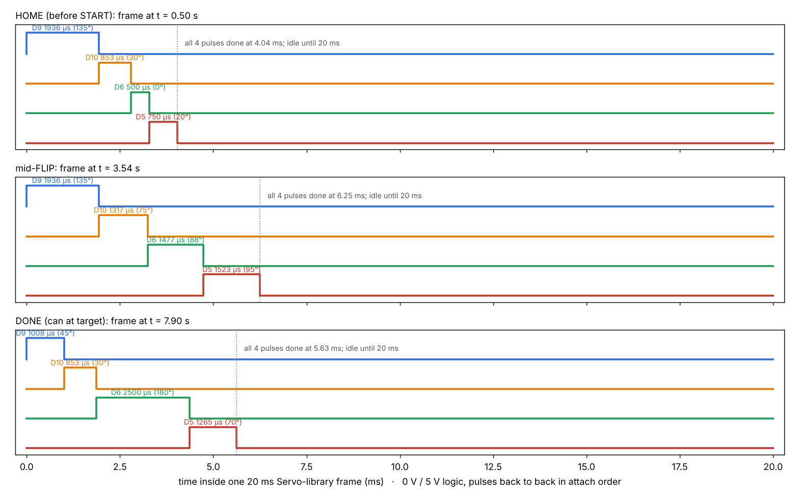
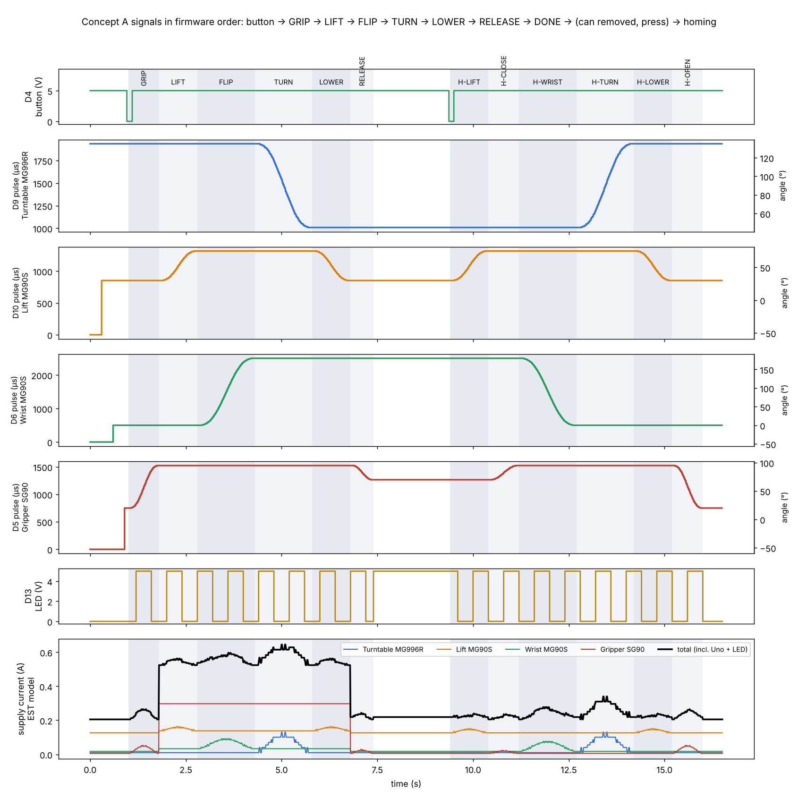
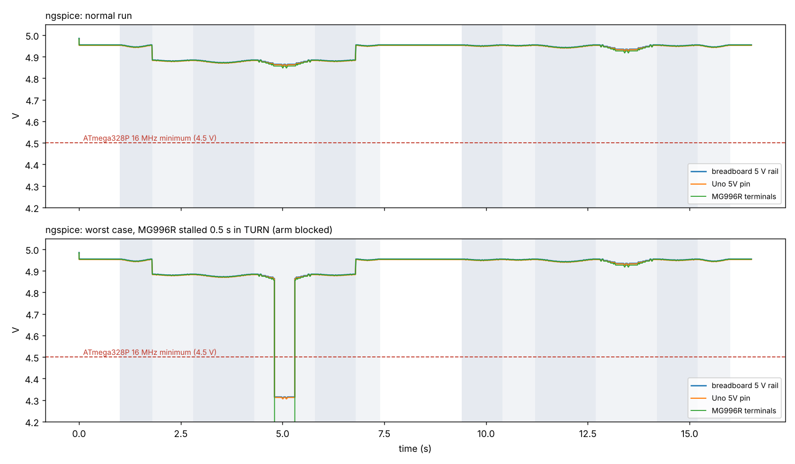
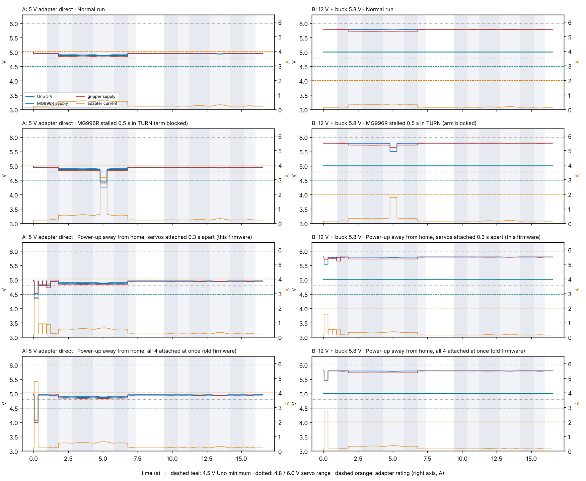

# EE: Concept A electronics calculations

Everything electrical lives here. One script makes all of it from the real firmware:

```bash
python3 backend/ee/ee_calcs.py      # numpy + matplotlib; runs the circuit too if ngspice is installed
```

| File | What |
|---|---|
| `out/signals_sequence.png` | Button, the 4 servo signals and the LED, in firmware order, plus the current model |
| `out/pwm_frames.png` | Inside one 20 ms frame: the 4 pulses back to back, at HOME, mid-FLIP and DONE |
| `out/pulse_table.csv` | Every 20 ms frame of the run: angle, pulse start and pulse width for each servo |
| `out/spice_rail.png` | ngspice: servo rail and Uno voltage, normal run and an MG996R stall |
| `out/power_compare.png` | **Buck or no buck**: both power designs in 4 cases, with every limit |
| `out/ee_report.txt` | All numbers below, as computed |
| `ltspice/concept_a_run.cir`, `concept_a_stall.cir` | **LTspice netlists**: File → Open (file type *Netlists*), then Run |
| `ltspice/concept_a.asc` | The same circuit as an LTspice schematic (`.step param STALL list 0 1`) |
| `ltspice/power_A_*.cir`, `power_B_*.cir` | The power comparison: A = 5 V direct, B = 12 V + buck; cases normal / stall / powerup / powerup_all |
| `ltspice/pwl/*.txt` | Signal and load waveforms the circuit plays (PWL files) |

The script re-runs the firmware loop exactly: same constants and step tables read from
`concept_a.ino`, same min-jerk ease and integer rounding, 10 ms loop. The START press is at
t = 1.0 s, and the homing press is 2 s after DONE (the can has been lifted off). Numbers marked
**EST** are typical datasheet values, not measurements.

The LTspice files were checked by running the same netlist in ngspice (it has no LTspice of its
own). The `.asc` schematic has not been opened in LTspice yet; if a part comes up unconnected,
use the `.cir` netlists, which hold the identical circuit.

## 1. The servo signal (wave) calculation

A hobby servo reads one pulse every 20 ms (50 Hz). The pulse width sets the angle:

**width (µs) = map(angle, 0, 180, min, max)** — the Arduino Servo library's own formula.
- Turntable, lift, gripper: default min/max = 544 / 2400 µs → 10.3 µs per degree.
- Wrist: attached with 500 / 2500 µs → 11.1 µs per degree, so an MG90S reaches a full 180°.
- Duty cycle: 544 / 20 000 = 2.7 % at 0°, 2400 / 20 000 = 12.0 % at 180° (wrist 2.5–12.5 %).

**The exact order on the pins.** On a Uno, the Servo library drives every servo from Timer1
(prescaler 8, 0.5 µs ticks). In each 20 ms frame it sends the pulses **one after another, in
attach order: D9 turntable → D10 lift → D6 wrist → D5 gripper**, then waits out the frame.
The longest possible chain is 2400 + 2400 + 2500 + 2400 µs = 9.7 ms, so all four always fit
in the 20 ms frame (`out/pwm_frames.png`). At power-up, `setup()` attaches the servos 0.3 s apart
(D9 at 0 s, D10 at 0.3 s, D6 at 0.6 s, D5 at 0.9 s), so each servo's pulses start on its own
(section 6 explains why).



**Pulse widths at the end of each step, in firmware order** (angle / µs):

| Step | Ends at t (s) | D9 turntable | D10 lift | D6 wrist | D5 gripper |
|---|---:|---|---|---|---|
| HOME | — | 135° / 1936 | 30° / 853 | 0° / 500 | 20° / 750 |
| GRIP | 1.80 | 135° / 1936 | 30° / 853 | 0° / 500 | **95° / 1523** |
| LIFT | 2.80 | 135° / 1936 | **75° / 1317** | 0° / 500 | 95° / 1523 |
| FLIP | 4.30 | 135° / 1936 | 75° / 1317 | **180° / 2500** | 95° / 1523 |
| TURN | 5.80 | **45° / 1008** | 75° / 1317 | 180° / 2500 | 95° / 1523 |
| LOWER | 6.80 | 45° / 1008 | **30° / 853** | 180° / 2500 | 95° / 1523 |
| RELEASE | 7.40 | 45° / 1008 | 30° / 853 | 180° / 2500 | **70° / 1265** |
| *can lifted off, button pressed* | | | | | |
| H-LIFT | 10.40 | 45° / 1008 | **75° / 1317** | 180° / 2500 | 70° / 1265 |
| H-CLOSE | 11.20 | 45° / 1008 | 75° / 1317 | 180° / 2500 | **95° / 1523** |
| H-WRIST | 12.70 | 45° / 1008 | 75° / 1317 | **0° / 500** | 95° / 1523 |
| H-TURN | 14.20 | **135° / 1936** | 75° / 1317 | 0° / 500 | 95° / 1523 |
| H-LOWER | 15.20 | 135° / 1936 | **30° / 853** | 0° / 500 | 95° / 1523 |
| H-OPEN | 16.00 | 135° / 1936 | 30° / 853 | 0° / 500 | **20° / 750** |

Bold = the servo that moves in that step. Only one servo moves at a time. Between the step ends
each pulse width follows the slow–fast–slow (minimum-jerk) curve, updated every 20 ms:



The LED on D13 blinks (400 ms on / off) while moving, stays on at DONE, and is off at home.

## 2. Current budget

Model per servo (**EST**): *idle* + *running current × commanded speed / no-load speed* +
*stall current × holding torque / stall torque*. Holding torques come from the CAD loads.

| Servo | Idle | Running (full speed) | No-load speed | Stall | Holding torque in the run |
|---|---:|---:|---:|---:|---|
| MG996R turntable | 10 mA | 0.30 A | 330 °/s | 2.5 A @ 9.4 kg·cm | ≈ 0 (weight on the 6807 bearing) |
| MG90S lift | 10 mA | 0.15 A | 600 °/s | 0.7 A @ 1.8 kg·cm | 0.33 kg·cm with the can |
| MG90S wrist | 10 mA | 0.15 A | 600 °/s | 0.7 A @ 1.8 kg·cm | 0.06 kg·cm with the can |
| SG90 gripper | 6 mA | 0.15 A | 600 °/s | 0.65 A @ 1.6 kg·cm | 0.72 kg·cm while squeezing (below) |

Plus the Uno board ≈ 45 mA and the LED 13.6 mA.

| Step | Peak total current |
|---|---:|
| GRIP | 0.26 A |
| LIFT | 0.56 A |
| FLIP | 0.60 A |
| **TURN** | **0.65 A** (largest) |
| LOWER | 0.56 A |
| RELEASE | 0.24 A |
| Homing steps | ≤ 0.34 A |

**Peak 0.65 A vs the 5 A buck: 7.7× margin** (12 V side ≈ 0.35 A + 0.06 A for the Uno). The biggest steady load is not a moving servo but
the gripper holding the can:

- Squeeze 0.8 N per arm × 44 mm lever (finger pivot y = 83 mm to can centre y = 127 mm) × 2
  arms = 7.0 N·cm = **0.72 kg·cm = 45 % of the SG90 stall torque → ≈ 0.29 A** for the ~5 s it
  holds the can (GRIP end to RELEASE).
- The SG90 can make at most 1.6 kg·cm / (2 × 4.4 cm) = **1.8 N per arm** here. Set
  `GRIP_CLOSED` for **0.5–1 N per arm** (minimum 0.39 N for a 3× slip margin, dents at ~8 N).
  Squeezing harder would leave the SG90 near stall and warm.

Worst cases outside the normal run:
- **One MG996R stall** (arm blocked): +2.5 A → about 3.1 A at the buck, inside 5 A. Simulated below.
- **Power-up away from home:** each servo jumps to its home angle at stall current. All four at
  once would pull 4.7 A. That is over a 12 V 2 A adapter's limit (≈ 2.75 A drawn), so the firmware
  attaches them 0.3 s apart: the worst moment is then one MG996R jump.

## 3. Supply path and rail voltage (selected design: 12 V adapter + buck)

| Element (EST) | Value |
|---|---:|
| 12 V 2 A adapter (load regulation) | 0.15 Ω |
| 1.5 m cord, 2 × 20 AWG | 0.10 Ω + 1.5 µH |
| DC jack | 0.01 Ω |
| XL4015 module: input capacitor / output resistance / efficiency | 220 µF / 0.03 Ω / 90 % |
| Buck output → breadboard servo rail (jumpers + contacts) | 0.05 Ω |
| Servo leads (MG996R 0.08 Ω, on the buck terminals; others 0.13 Ω with 300 mm extensions) | per servo |
| Uno: VIN → M7 diode (≈ 1.0 V) → NCP1117 5 V regulator (dropout ≈ 1.1 V) | — |

Hand calc: servo rail drop at the normal peak 0.65 A × 0.08 Ω = **0.05 V → ≈ 5.75 V**. 12 V side:
5.8 V × 0.65 A / (0.9 × 12 V) = **0.35 A**, plus 0.06 A for the Uno. The Uno's regulator burns
(11 V − 5 V) × 0.06 A = **0.35 W**, fine for its SOT-223 package (~1 W).

ngspice, the full circuit with the real signal and current waveforms (`out/spice_rail.png`):

| Case | Servo rail | Uno 5V | MG996R min | Gripper min |
|---|---:|---:|---:|---:|
| Normal run | 5.76–5.79 V | 5.00 V | 5.77 V | 5.72 V |
| MG996R stalled 0.5 s in TURN | 5.68–5.79 V | 5.00 V | 5.50 V | 5.64 V |



**The 1000 µF capacitor** on the servo rail covers fast current steps. A 1 A step for 100 µs
droops it by 1 A × 100 µs / 1000 µF = 0.10 V. Rated ≥ 10 V, − leg to GND.

## 4. Small parts

| Part | Calculation | Result |
|---|---|---|
| Status LED on D13 | (5.0 V − 2.0 V Vf) / 220 Ω | **13.6 mA** (pin limit 20 mA recommended, 40 mA absolute) |
| START button on D4 | `INPUT_PULLUP` 20–50 kΩ to 5 V | 0.1–0.25 mA when pressed; debounced 40 ms in code |
| Servo signal pins D9, D10, D6, D5 | Servo signal input ≈ 10 kΩ (EST) | < 1 mA each |
| Total from Uno pins | 13.6 + 4 × 0.5 + 0.25 | ≈ 16 mA (ATmega328P total limit 200 mA) |

## 5. Rules that come out of these numbers

1. Set the buck to **5.8 V with a meter before connecting any servo** (MG90S / SG90 max 6.0 V).
2. The **MG996R's + / − go straight to the buck OUT terminals**, not the breadboard (a stall is
   2.5 A; breadboard contacts are good for about 1 A).
3. Calibrate `GRIP_CLOSED` for a light squeeze (0.5–1 N per arm). Holding the can is the biggest
   steady load.
4. Keep the firmware's staggered `attach()` (0.3 s apart).
5. USB can stay plugged in with the adapter: the Uno switches USB power off above 6.6 V on VIN.

## 6. Buck or no buck: both power designs simulated

- **A:** a 5 V 4 A adapter wired straight to the servo rail and the Uno's 5V pin. No buck.
- **B (selected):** a 12 V 2 A adapter to the Uno's VIN, plus an XL4015 at 5.8 V for the servos.

Both use the same servo currents, wiring resistances and firmware, and in both the MG996R's power
goes straight to the supply terminals. Four cases: a normal run; the MG996R stalled for 0.5 s in
TURN (arm blocked); power-up away from home with this firmware (servos attached 0.3 s apart); and
power-up away from home with all four attached at once (the old firmware).

| Check (limit) | A normal | A stall | A power-up | **B normal** | **B stall** | **B power-up** |
|---|---|---|---|---|---|---|
| Uno 5 V (≥ 4.5 V for 16 MHz) | 4.86 ✔ | **4.43 ✘** | 4.52 ✔ | 5.00 ✔ | 5.00 ✔ | 5.00 ✔ |
| Servo supply (≥ 4.8 V rated) | 4.82 ✔ | **4.25 ✘** | **4.34 ✘** | 5.72 ✔ | 5.50 ✔ | 5.52 ✔ |
| Servo supply (≤ 6.0 V) | 4.95 ✔ | ✔ | ✔ | 5.79 ✔ | ✔ | ✔ |
| Adapter current (A: 4 A, B: 2 A) | 0.66 ✔ | 3.16 ✔ | 2.72 ✔ | 0.38 ✔ | 1.79 ✔ | 1.54 ✔ |
| Buck current (≤ 5 A) | — | — | — | 0.60 ✔ | 3.10 ✔ | 2.66 ✔ |
| Breadboard rail current (≤ ~1 A) | 0.59 ✔ | 0.94 ✔ | 0.91 ✔ | 0.53 ✔ | 0.54 ✔ | 0.85 ✔ |
| USB plugged in while powered | ✘ two 5 V sources | | | ✔ Uno switches USB off | | |

With the old all-at-once power-up, both adapters were overloaded: A drew 4.77 A of its 4 A and B
drew 2.75 A of its 2 A. Staggering the attach fixed both. That is why the firmware does it.



**Conclusion: keep the buck.** Both designs pass the normal run, so the robot would work either
way. The difference shows in the fault cases:
- Without the buck, the Uno shares the servo rail. A blocked arm drops it to 4.43 V, below its
  16 MHz minimum (it won't reset, since brown-out is 2.7 V), and the servos sag to 4.25 V,
  below their rating.
- With the buck, the Uno sits on its own regulator and holds 5.00 V in every case, and the servos
  never drop below 5.5 V.
- The buck also lets USB stay plugged in, so the Serial Monitor can stay open while you calibrate
  the servo angles. With A you'd have to unplug the adapter every time.

The cost is $5 and setting the buck once with a meter. Power decision matrix: B 7/9, A 6/9
(`docs/decision_matrix_and_bom.xlsx`).

## How the LTspice circuit is built

| Block | In the netlist |
|---|---|
| Adapter, cord, jack | `VADP` 12 V → `RADP` → `RCORD` + `LCORD` → `RJACK` → node `vin` (+ `CIN` 220 µF) |
| XL4015 buck (averaged) | `BBUCK` 5.8 V → `VSENSE` → `RBOUT` 0.03 Ω → node `bk`; `BBIN` draws Pout / (0.9 × Vin) from `vin` |
| Breadboard rail | `VRAIL` (current sense) → `RRAIL` → node `rail`; `CRAIL` 1000 µF + `RESR` 0.08 Ω |
| 4 servos | lead resistor + current source playing `pwl/i_*.txt` (EST current model); the MG996R hangs on `bk`, the others on `rail` |
| Stall test | `ISTALL` 2.5 A for 0.5 s in the middle of TURN (`STALL` = 1) |
| Uno | `RVIN` → node `vinu` (45 mA load); `BREG` makes `uno5v` = min(5 V, VIN − 2.1 V) |
| Servo signals | `VSIG_D9 / D10 / D6 / D5` play `pwl/sig_D*.txt` (the exact pulse trains) through 25 Ω pins into ~10 kΩ servo inputs |
| LED | `VLED_D13` → 25 Ω → 220 Ω → LED model (Vf ≈ 2.0 V at 13.6 mA) |
| Button | 35 kΩ pull-up to `uno5v`, switch `SBTN` to GND, pressed at 1.0 s and 9.4 s |

Plot in LTspice: `V(rail)`, `V(uno5v)`, `V(vin)`, `V(d9)` `V(d10)` `V(d6)` `V(d5)` (zoom into any 20 ms to see
the four pulses in order), `V(d13)`, `V(d4)`.

## Final power design: Uno on its own 9 V battery

The Uno now runs from its own 9 V battery (barrel jack or VIN); the 12 V adapter feeds only the XL4015
buck for the servos. All grounds stay joined. `python3.13 backend/ee/power_final.py` simulates it in
ngspice (netlists `EE/ltspice/power_final_*.cir`, open them in LTspice too) and writes
`EE/out/power_final_report.txt` + `power_final.png`:

- Uno 5 V: 5.00 V (4.92 V on a nearly flat 7.2 V battery) in a normal run, MG996R stall and power-up.
- Servo supply ≥ 5.51 V in every case; adapter ≤ 1.69 A (2 A rating).
- 1000 µF capacitor: no difference at the ms scale; in the worst fast inrush (all four servos within
  0.6 ms) the supply dips to 4.65 V / rings to 6.6 V without it, 5.11 V / 6.15 V with it. Optional
  while testing, fit it for the final runs.
- Battery life ~9 h (59 mA). Schematic: `docs/wiring/schematic.png` (`backend/ee/schematic.py`).
