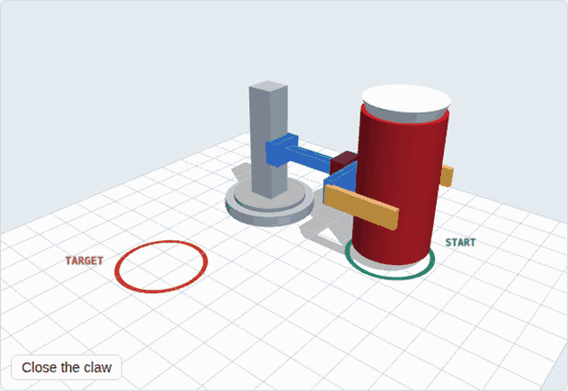

# ME 2331/L Project 2: Design, Build, Test (can-flipping robot)

An Arduino Uno robot takes an empty soda can standing upright 5 in from the robot, **turns it
upside down, and sets it down free-standing 90° away** at the same radius.

## Selected design: Concept A (claw + wrist flip + turntable)

A small crane at the corner, with 4 hobby servos doing one move at a time:
**grip → lift 0.6 in → wrist flips 180° → turntable turns 90° → lower → release** (6.4 s).

- **The 90° is literal:** the turntable sits at the robot's location, so the robot visibly turns
  90° and the can stays 5 in away the whole time.
- **The lift is required:** without it, the flipping can dips 0.29 in into the table. With a
  0.6 in lift it clears by 0.31 in.
- **Electronics are servos only:** no encoder, motor driver or PID tuning. The code is one file
  that runs in the Arduino IDE, Tinkercad and Wokwi.



Why A: [the decision matrix](docs/01_concepts_and_decision_matrix.md). The team ranking is
A 3.85 → B 3.30 → D 3.00 → C 2.75.

## Repo map

**Concept A (current design)**

| Path | What |
|---|---|
| `docs/Project_Notes_ConceptA.docx` | Plain notes to share: how it works, materials, BOM, GIF placements |
| `docs/01_concepts_and_decision_matrix.md` | 4 concepts, team matrix with the calculation, first-pass matrix |
| `docs/02_design_analysis.md` | Lift clearance, motion profile, grip force, servo sizing, lift jam check, error budget, power |
| `docs/03_cad_spec.md` | SolidWorks / Fusion brief: frame, joints, part dimensions, checks |
| `docs/04_wiring_and_bom.md` | Power, pin map, BOM (≈ $50–65) |
| `docs/05_rvtm.md` | Requirements traceability matrix (Part C 4a) |
| `docs/06_pdr_outline.md` | Slide-by-slide PDR plan with GIFs and timing |
| `firmware/concept_a/concept_a.ino` | **The Arduino code** (4 servos, eased moves, optional IR / FSR) |
| `docs/tinkercad_concept_a.md`, `wokwi/concept_a/` | Breadboard simulation: Tinkercad step by step, Wokwi diagram |
| `sim/concept_a.py` | Design calcs (reads the angles and times from the firmware) → `sim/out/concept_a*` |
| `cad/concept_a_detail/` | **Detail (printable) CAD**: `model.py` (all parts + kinematics), `check.py` (firmware sequence collision / mass / load check), `export.py` (STEP for SolidWorks/Fusion, STL), `fusion_animate/` (Fusion 360 motion script). Write-up: `docs/07_detail_design.md`; 3D page: `viewer/concept_a_detail.html` |
| `cad/build_cad_concept_a.py` → `cad/out/concept_a/` | Concept STEP assembly (fixed / turret / lift / wrist groups) + per-part STEP/STL |
| `tools/emulate_concept_a.sh` | Compiles the sketch with avr-gcc and runs it on an emulated Uno |
| `viewer/concepts.html`, `viewer/gifs/` | All 4 concepts animated, and looping GIFs for docs and slides |

**Concept D (mirror flip): alternative, kept for reference**

| Path | What |
|---|---|
| `docs/concept_d/` | Its full design analysis, CAD brief, wiring/BOM, RVTM, PDR plan, notes doc |
| `firmware/can_flipper/`, `firmware/host_test/` | Closed-loop PID firmware + laptop regression test |
| `sim/params.py`, `flip_geometry.py`, `flip_control.py`, `grip_control.py`, `mechanism.py` | D's geometry, control and collision sims |
| `cad/build_cad.py` → `cad/out/` | D's concept STEP |
| `viewer/index.html`, `wokwi/concept_d/`, `tools/emulate_uno.sh` | D's firmware replay, Wokwi, emulator |

## Run it

**Laptop setup, step by step (Windows/macOS): [docs/00_local_setup.md](docs/00_local_setup.md).**

```bash
pip install -r sim/requirements.txt
python3 sim/concept_a.py                    # Concept A calcs -> sim/out/concept_a.txt + plots
tools/emulate_concept_a.sh                  # emulated Uno run (needs: apt install gcc-avr avr-libc simavr)
python3 cad/build_cad_concept_a.py          # STEP/STL (pip install cadquery)
```

Arduino IDE: open `firmware/concept_a/concept_a.ino`, board = Uno, then press the button.
The Serial Monitor at 9600 baud shows each step.

## Status

Done (laptop only):
- [x] 4 concepts, animated; team decision matrix → Concept A
- [x] Design calcs: lift clearance, grip force, servo loads, lift jam check, error budget, power
- [x] Arduino code, verified on an emulated Uno (full sequence, eased moves)
- [x] Tinkercad and Wokwi wiring; concept CAD (STEP); BOM, RVTM, PDR plan, notes doc

Still to do:
- [ ] Hand sketches of the 4 concepts
- [ ] SolidWorks CAD per `docs/03_cad_spec.md`; put the masses back into `sim/concept_a.py`
- [ ] Order the servos (check the wrist servo reaches a full 180°), lazy-susan, LM6UU, 5 A supply
- [ ] Calibrate the servo angles on the real robot (constants at the top of the code)
- [ ] Crush-test scrap cans; measure the can's top rim
- [ ] Build the PDR deck from `docs/06_pdr_outline.md`
