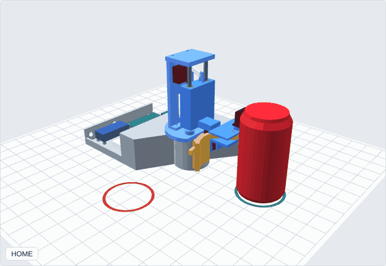
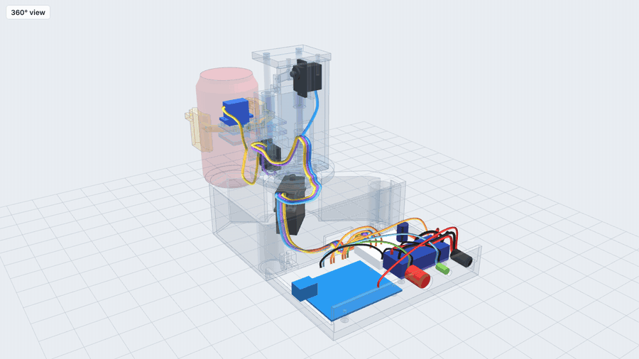

# ME 2331/L Project 2: Design, Build, Test (can-flipping robot)

An Arduino Uno robot takes an empty Coke can (66.2 × 122.2 mm) standing upright 5 in from the
robot, **turns it upside down, and sets it down free-standing 90° away** at the same radius.

## Selected design: Concept A (claw + wrist flip + turntable)

A small crane at the corner, with 4 hobby servos doing one move at a time:
**grip → lift 0.6 in → wrist flips 180° → turntable turns 90° → lower → release** (6.4 s).

- **The 90° is literal:** the turntable sits at the robot's location, so the robot visibly turns
  90° and the can stays 5 in away the whole time.
- **The lift is required:** without it, the flipping can dips 0.33 in into the table. With a
  0.6 in lift it clears by 0.27 in.
- **Electronics are servos only:** no encoder, motor driver or PID tuning. The code is one file
  that runs in the Arduino IDE, Tinkercad and Wokwi.



Why A: [the decision matrix](docs/01_concepts_and_decision_matrix.md). The team ranking is
A 3.85 → B 3.30 → D 3.00 → C 2.75.

## Open in the browser (live site)

| Page | Link |
|---|---|
| Home (all viewers) | https://jackpham-rgb.github.io/MEproject2026F/ |
| **Wiring, 360°** (drag to orbit, Legend on/off) | https://jackpham-rgb.github.io/MEproject2026F/viewer/wiring_360.html |
| **Wiring through each move** (grip, lift, flip, turn, lower, release) | https://jackpham-rgb.github.io/MEproject2026F/viewer/wiring_motion.html |
| **Control panel**: drive the robot from a laptop over USB (Chrome / Edge) | https://jackpham-rgb.github.io/MEproject2026F/viewer/control_panel.html |
| **Detail CAD, animated** (firmware sequence + checks) | https://jackpham-rgb.github.io/MEproject2026F/viewer/concept_a_detail.html |
| All 4 concepts | https://jackpham-rgb.github.io/MEproject2026F/viewer/concepts.html |
| Wiring video, with legend / without | https://jackpham-rgb.github.io/MEproject2026F/docs/wiring/wiring_360.mp4 · https://jackpham-rgb.github.io/MEproject2026F/docs/wiring/wiring_360_clean.mp4 |

The site is GitHub Pages, published from the `claude/awesome-brahmagupta-i4dvbh` branch (root).
The same files open offline: download the repo and double-click the `.html` (needs internet for the 3D library).



## Repo map

| Folder | What's in it |
|---|---|
| **`cad/`** | CAD files only. `step/concept_a_assembly.step` (**open in SolidWorks / Fusion**) + `step/parts/`; `print/stl/` (print-ready STLs); `check/` (collision, mass and **43 engineering checks**: `mech_report.txt`); `claw/` (claw-only STEP for a close-up Fusion animation); `wiring/` (wires as solids + routing check). See `cad/README.md` |
| **`docs/`** | Everything to read or hand in: concepts and decision matrix (01), analysis (02), detail design (03), wiring (04), BOM (05), RVTM (06), PDR plan (07), **build guide (08)**, **how the motors and claw work (09)**, **wire routing in 3D (10)**, **prototype v1 BOM: have / must buy / find at home (11)**, **assembly manual, IKEA style (12, PDF)**, **electronics bench test (13)**, **Plan P quick prototype (14)**, **CR-6 SE print troubleshooting (15)**, **Part C report** (`Engineering_Report_ConceptA.docx`), **2D drawings** (`drawings/all_drawings.pdf`), Excel matrices + BOM, wiring diagram |
| **`EE/`** | Electronics results: servo PWM signals in firmware order, current budget, buck-vs-no-buck comparison, **LTspice circuit** (`EE/ltspice/`) |
| **`firmware/`** | Arduino code: `concept_a/` (the robot), `servo_setup/` (fit horns at HOME, find calibration angles) |
| **`sim/`** | Design-calc results (lift clearance, grip, servo loads) |
| **`viewer/`** | Open in a browser (or on the [project site](https://jackpham-rgb.github.io/MEproject2026F/)): the detail CAD animated through the firmware sequence, the **360 wiring view**, all 4 concepts, GIFs |
| **`wokwi/`** | Wokwi breadboard simulation (Tinkercad steps: `docs/tinkercad_concept_a.md`) |
| **`backend/`** | All the code that generates the files above: `cad/` (CAD model, checks, exports, drawings, print prep), `ee/`, `sim/`, `tools/` (BOM, wiring diagram, viewers, report, emulator). See `backend/README.md` |

Older concept-stage files (the Concept D design, the block-level CAD) were removed from the
branch; they are still in the git history.

## Run it

**Laptop setup, step by step (Windows/macOS): [docs/00_local_setup.md](docs/00_local_setup.md).**

```bash
pip install -r backend/requirements.txt cadquery
python3 backend/cad/check.py      # motion + collision check (~5 min) -> cad/check/
python3 backend/cad/export.py     # STEP -> cad/step/
```

Every generator and the order to run them: [backend/README.md](backend/README.md).

Arduino IDE: open `firmware/concept_a/concept_a.ino`, board = Uno, then press the button.
The Serial Monitor at 9600 baud shows each step.

## Status

Done (laptop only):
- [x] 4 concepts, animated; team decision matrix → Concept A
- [x] Design calcs: lift clearance, grip force, servo loads, lift jam check, error budget, power
- [x] Detail CAD with PETG tolerances and kit screws; no collisions over the full firmware sequence
- [x] Engineering checks: 43/43 pass (servo duty, lift mechanism, involute gears, can grip, dynamic stability, strength, power)
- [x] Arduino code, verified on an emulated Uno; Tinkercad and Wokwi wiring
- [x] Wiring diagram, BOM with reasons, binary decision matrices (Excel), RVTM, PDR plan
- [x] Part C: 2D drawings (13 sheets) and the engineering report (results section waits for the build)

Still to do:
- [ ] Hand sketches of the 4 concepts; PDR deck from `docs/07_pdr_outline.md`
- [ ] Print the tolerance coupon, then the parts; order the purchased parts (`docs/05_bom.md`)
- [ ] Measure the real servos / bearing and update `P` in `backend/cad/model.py`
- [ ] Calibrate the servo angles on the real robot (constants at the top of the code)
- [ ] Part C: add test results and photos to the report after the build
