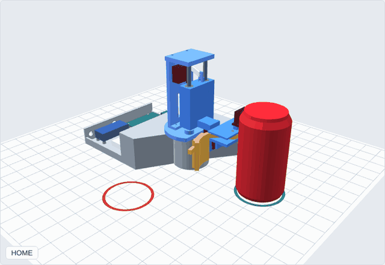

# ME 2331/L Project 2: can-flipping robot (Concept A)

An Arduino Uno robot picks up an empty Coke can standing 5 in away, **turns it upside down and sets it
down free-standing 90° around the robot**: grip → lift 0.6 in → wrist flips 180° → turntable turns 90° →
lower → release (7.4 s, one button press).

Live site: **https://jackpham-rgb.github.io/MEproject2026F/** (all the pages below, also on a phone).

## Start here

| I want to… | Open |
|---|---|
| **Build it** | [Assembly manual (PDF)](docs/12_assembly_manual.pdf) · [3D step-by-step guide](viewer/assembly.html) (rotate / zoom, screw paths, fit levels) |
| **Print the parts** | [`cad/print/`](cad/print/README.md): plates A–E (settings inside), tolerance gauge, printer tune-up |
| **Wire and test the electronics** | [Wiring](docs/04_wiring.md) · [Bench test](docs/13_electronics_bench_test.md) · [Laptop control panel](viewer/control_panel.html) |
| **Upload the code** | `firmware/concept_a/concept_a.ino` (Arduino IDE, board Uno) |
| **See it meets the assignment** | [Requirements page](viewer/requirements.html) · [RVTM](docs/06_rvtm.md) |
| **Hand in / report** | [Engineering report](docs/Engineering_Report_ConceptA.docx) · [2D drawings](docs/drawings/all_drawings.pdf) · [BOM](docs/05_bom.md) |
| **Buy parts** | [Prototype BOM: have / buy / find at home](docs/11_bom_prototype_v1.md) |

## Folders

| Folder | What's in it |
|---|---|
| `docs/` | Everything to read: design (01–03, 09), wiring (04, 10), BOMs (05, 11), RVTM (06), build guide (08), manual (12), bench test (13), printing (15–18), report, drawings |
| `cad/` | CAD: `step/` (open in SolidWorks / Fusion), `print/` (what to print + settings), `check/` (collision + engineering checks) |
| `firmware/` | Arduino code: `concept_a/` (the robot), `servo_setup/`, `bench_test/` |
| `viewer/` | Web pages: 3D assembly guide, control panel, CAD and wiring viewers, requirements |
| `EE/`, `sim/` | Electronics simulation (power, LTspice) and design-calc results |
| `backend/` | The code that generates all of the above ([backend/README.md](backend/README.md)) |
| `archive/` | Old or replaced material, kept for reference (Plan P, no-printer fallback, PDR outline, draft notes, old plates, Tinkercad / Wokwi) |

## Docs

| # | Doc | # | Doc |
|---|---|---|---|
| 00 | [Laptop setup](docs/00_local_setup.md) | 10 | [Wire routing in 3D](docs/10_wiring_3d.md) |
| 01 | [Concepts + decision matrix](docs/01_concepts_and_decision_matrix.md) | 11 | [Prototype BOM](docs/11_bom_prototype_v1.md) |
| 02 | [Design analysis](docs/02_design_analysis.md) | 12 | [Assembly manual (PDF)](docs/12_assembly_manual.pdf) |
| 03 | [Detail design](docs/03_detail_design.md) | 13 | [Electronics bench test](docs/13_electronics_bench_test.md) |
| 04 | [Wiring](docs/04_wiring.md) | 15 | [Print troubleshooting (CR-6 SE)](docs/15_cr6se_print_troubleshooting.md) |
| 05 | [BOM](docs/05_bom.md) | 16 | [Print settings per plate](docs/16_print_economy.md) |
| 06 | [RVTM](docs/06_rvtm.md) | 17 | [Tolerance re-check sheet](docs/17_tolerance_recheck.md) |
| 08 | [Build guide](docs/08_build_guide.md) | 18 | [Printer tune-up, PLA + PETG](docs/18_cr6se_tuneup.md) |
| 09 | [How the motors and claw work](docs/09_how_it_moves.md) | | |

## Status

- Design, CAD, engineering checks, firmware and electronics: done; firmware runs on the Uno, all servos move.
- Now: tolerance gauge → correct the hole sizes → print plates B–E → assemble → calibrate → test runs (Part B).

Regenerating files, checks and the order to run them: [backend/README.md](backend/README.md).
