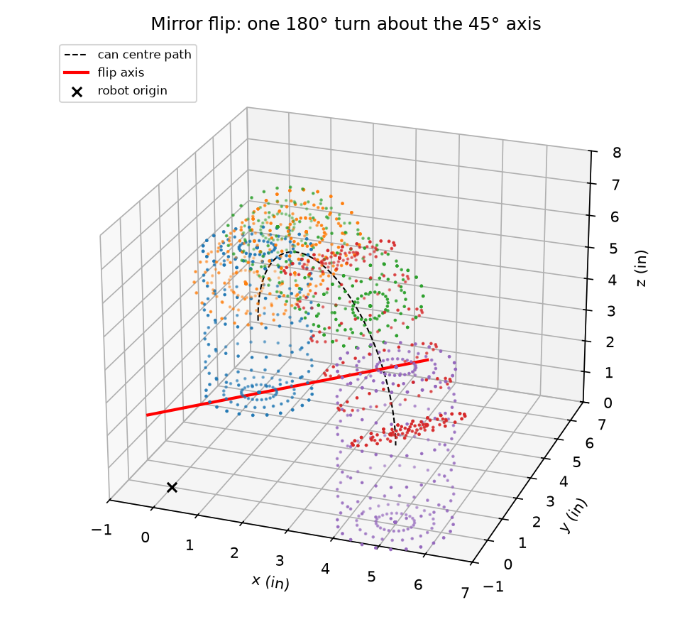

# ME 2331/L Project 2: Design, Build, Test (can-flipping robot)

An Arduino Uno robot takes an empty soda can standing upright 5 in from the robot, **turns it
upside down, and sets it down free-standing 90° away** at the same radius.

## The design in one sentence

One horizontal axis along the 45° bisector, at can mid-height (2.39 in). A **single 180° turn
about it flips the can and moves it 90° at the same time**: in plan view it mirrors START onto
TARGET. So the robot needs only two actuators: a closed-loop flip gearmotor with an encoder, and
a force-controlled grip servo with an FSR.



Why this concept and not the claw + turntable: see [the decision matrix](docs/01_concepts_and_decision_matrix.md).
The short answer is that a can gripped at mid-height can't be flipped in place without also
adding a lift axis.

## Repo map

| Path | What |
|---|---|
| `docs/01_concepts_and_decision_matrix.md` | 4 concepts, weighted matrix, sensitivity check (PDR items 1–2) |
| `docs/02_design_analysis.md` | Geometry, error budget, loads, motor sizing, control design, verification, plan changes |
| `docs/03_cad_spec.md` | SolidWorks modelling brief: frame, keep-outs, critical dimensions |
| `docs/04_wiring_and_bom.md` | Power architecture, pin map, draft BOM |
| `docs/05_rvtm.md` | Requirements traceability matrix (draft; Part C 4a) |
| `docs/06_pdr_outline.md` | Slide-by-slide PDR plan with figures and timing |
| `sim/` | Python: `flip_geometry.py` (clearance sweep), `flip_control.py` (plant + pole placement + robustness), `grip_control.py` (force loop), `plot_telemetry.py` (plots Uno CSV logs, sim or bench) |
| `firmware/can_flipper/` | Uno sketch. `control.h` / `sequencer.h` are hardware-free; `plant_model.h` is the simulated mechanism |
| `firmware/host_test/` | Laptop regression test of the real firmware logic (nominal, ±30 % spreads, fault injection) |
| `tools/emulate_uno.sh` | Builds the sketch with avr-gcc and runs the real AVR binary in simavr |
| `wokwi/` | Wokwi diagram for a browser simulation |

## Run it

```bash
pip install -r sim/requirements.txt
python3 sim/flip_geometry.py && python3 sim/flip_control.py && python3 sim/grip_control.py   # -> sim/out/
make -C firmware/host_test                  # full-sequence + fault tests, prints "all checks passed"
tools/emulate_uno.sh                        # needs: apt install gcc-avr avr-libc simavr
```

Arduino IDE: open `firmware/can_flipper/can_flipper.ino`, board = Uno, Serial Monitor at 250000 baud.
Commands: `g` start, `r` reset after a fault, `i` open-loop step for system ID.

## Phase 1 status (laptop only)

Done here:
- [x] 4 concepts + weighted decision matrix → Concept D
- [x] Geometry / collision sweep through the full flip (replaces Gazebo for this 1-DOF mechanism)
- [x] Plant models, pole-placement PID + feedforward, robustness sims, predicted step metrics
- [x] Grip force window (slip 0.44 N / dent ~8 N) and force-loop sim
- [x] Firmware: 200 Hz timer tick, quadrature ISR, state machine with faults, telemetry, system-ID mode
- [x] Firmware verified on the laptop (11/11 scenarios) and as a real AVR binary in an emulator (1.49 ms of the 5 ms tick)
- [x] Draft RVTM, BOM, pin map, CAD brief, PDR slide plan

Still yours to do:
- [ ] Hand sketches of the 4 concepts; team review of the matrix weights
- [ ] SolidWorks preliminary CAD per `docs/03_cad_spec.md`, then put mass properties back into `sim/params.py`
- [ ] Order the gearmotor + encoder, TB6612, FSR 402, microswitch, 5 V buck (longest lead item: the motor)
- [ ] Build the PDR deck from `docs/06_pdr_outline.md`
- [ ] Measure a real can: top-rim radius (`CAN_RIM_R`), and a crush test for the dent force

## Numbers that are still estimates

Motor stall torque and speed, reflected rotor inertia, friction, pad friction coefficient and
stiffness, dent force, moving masses. All of them are in `sim/params.py` and `firmware/can_flipper/config.h`
and marked **ESTIMATE**. Phase 2 step 1 is system ID (`i` command → fit K, τ → rerun
`flip_control.py` → copy the gains into `config.h` → `make -C firmware/host_test`).
