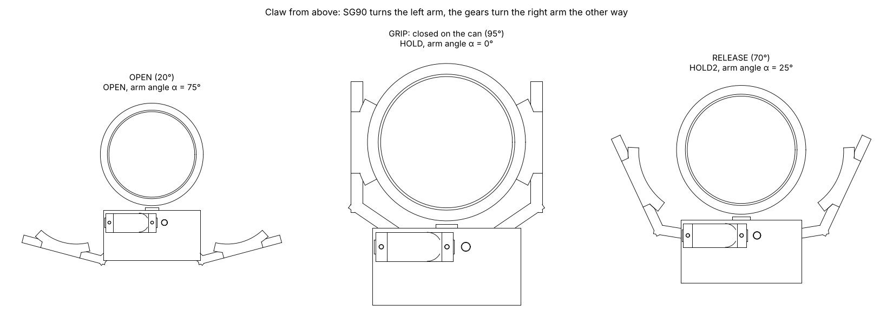

# Claw only: close-up for Fusion 360

| File | What |
|---|---|
| `claw.step` | Gripper frame + SG90 + wrist servo and horn (`grp_frame`), the two geared arms (`grp_finger_L`, `grp_finger_R`), the can (`grp_can`). Opens in SolidWorks and Fusion |
| `claw_sequence.json` | Arm positions for open → close on the can → hold → release 25° → open (firmware angles 20°, 95°, 70°) |

## Play it in Fusion (4 files)

- From this folder: `claw.step` + `claw_sequence.json`, kept together in one folder.
- From `backend/cad/fusion_claw/`: `fusion_claw.py` + `fusion_claw.manifest`, in a folder named
  exactly `fusion_claw`.

1. Fusion → **Shift + S** → **+** → pick the `fusion_claw` folder → select **fusion_claw** → **Run**.
2. Choose `claw.step`.
3. Read the explanation box (how the claw works), orbit to look down on the gears, press **OK**.
4. The claw plays (about 7 s, slowed down); the step name and servo angle show in the progress bar.
5. **Play again?** → Yes replays.

How the claw works: `docs/09_how_it_moves.md`. Regenerate after a CAD change:
`python3.13 backend/cad/export_claw.py`.
