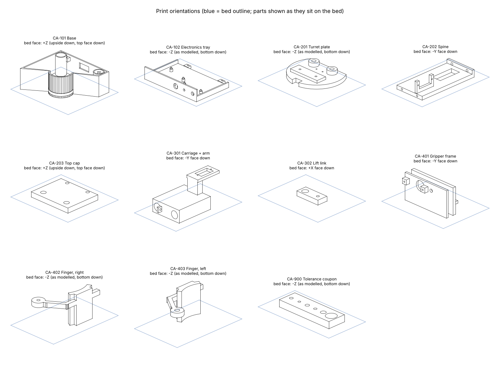

# Print files

Ready to slice: every STL in `stl/` is already turned to its best side and placed on the bed.
Settings, print order and the tolerance-coupon check: `docs/08_build_guide.md` section 2.

Regenerate after changing `backend/cad/model.py`: `python3.13 backend/cad/export.py && python3.13 backend/cad/print_prep.py`.
