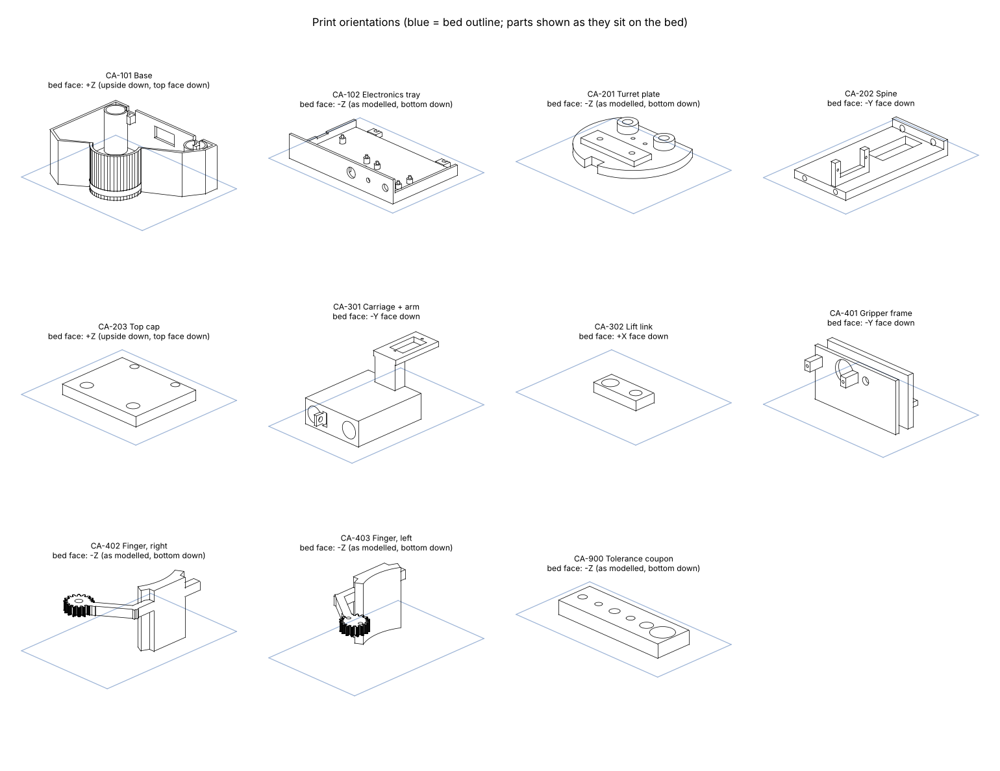

# What to print

| Folder | What | How |
|---|---|---|
| `tolerance_test/` | **Print first.** One-piece gauge for the bearing and claw fits (~1 h 20) | Open `tolerance_gauge.3mf` (Ctrl+O, "Yes"), slice, print; read `tolerance_test/README.md` |
| `plates/` | **Plates A–E**: every robot part, grouped by print quality, settings inside. `plate_R` = reprint of the turret plate, top cap and lift link | Open `plate_X.3mf`, delete parts you already have, slice |
| `stl/` | Single parts (already turned to their best side); `stl/finger_variants/` = looser / tighter gear pairs | Import into any slicer |
| `settings/` | `plates/plate_A..E.ini` (settings only, Ctrl+L), PETG base profile, `printer_settings.txt` | |
| `calibration/` | Printer tune-up kit, PLA + PETG: profiles, SD-card G-code (PID, e-steps), test prints | Follow `docs/18_cr6se_tuneup.md` |

Which settings each plate uses and why: `docs/16_print_economy.md` (and the manual's plate pages).
Printer problems: `docs/15_cr6se_print_troubleshooting.md`.

Regenerate after changing `backend/cad/model.py`: `python3.13 backend/cad/export.py && python3.13 backend/cad/print_prep.py`,
then `backend/tools/make_plate_inis.py` and `backend/tools/make_plate_files.py`.
