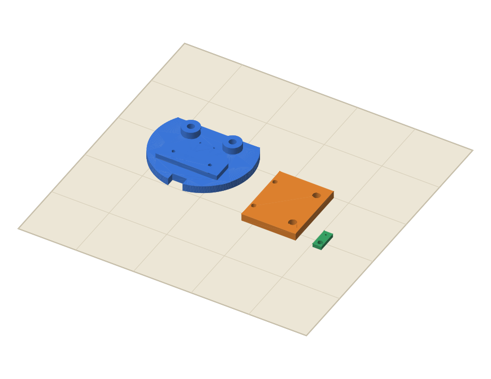

# Plate R: already printed (check + reprint)

The 3 parts that came off the original plate 1 besides the base. Check you have all three:

| Colour in the picture | File | Look for |
|---|---|---|
| blue | `CA-201_turret_plate.stl` | round-ish plate with a flat cut, 2 round bosses (rod holes) on top |
| orange | `CA-203_top_cap.stl` | small flat square plate, 2 big + 2 small holes |
| green | `CA-302_lift_link.stl` | tiny bar (16 × 7 × 3 mm) with 2 holes: easy to lose |

Lost or broken one? Open `plate_R.3mf` in PrusaSlicer (Ctrl+O, "Yes" to load its settings), delete the parts you
still have (right-click > Delete), slice. All three: ~3 h 50. Settings inside: 0.2 mm, 3 walls, 20 % gyroid,
normal supports from the bed (the turret plate needs them), 5 mm brim + solid on the lift link only.
