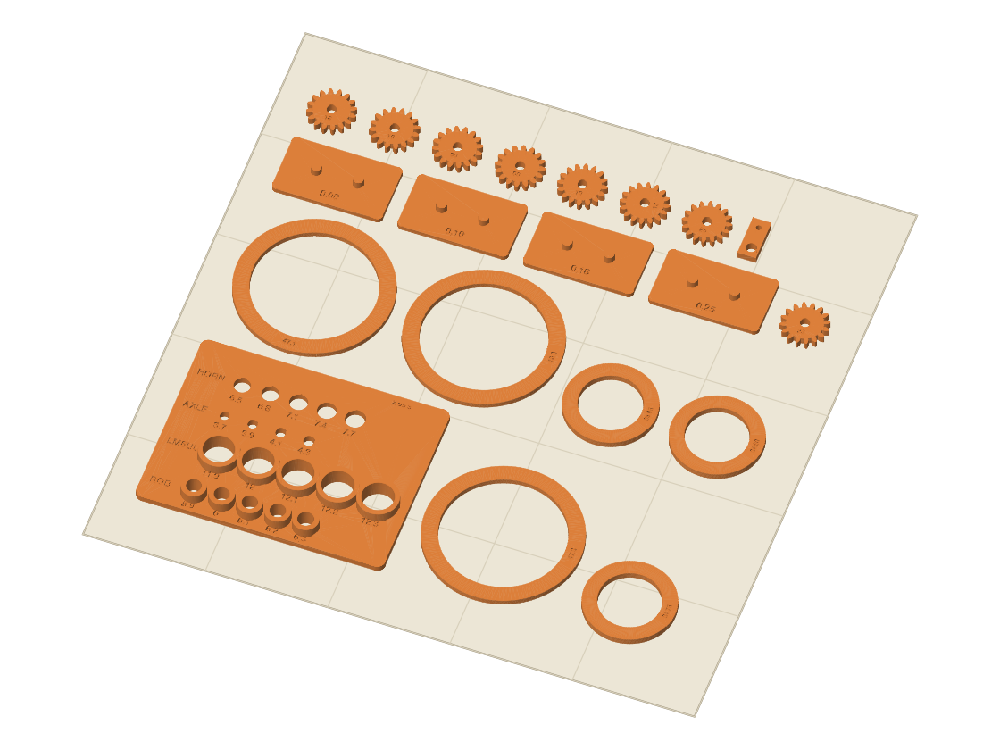

# Plate A: tolerance test for the bearings and the claw (+ new lift link)

**Print:** open `plate_A_gauge.3mf` in PrusaSlicer (Ctrl+O, "Yes" to load its settings), slice, print. About 5.5 h, ~46 g PETG,
0.2 mm layers, no supports, no brim (only the tiny lift link has one). Safe to leave running unattended.

Every size is engraved next to its hole / ring / disc (mm). Test with calipers **and** with the real parts.

| Piece | Test with | Write down |
|---|---|---|
| **ROD** row 5.9 … 6.3 | the 6 mm steel rod | the smallest hole it presses into by hand (press fit) and the one it slides through freely |
| **LM6UU** row 11.9 … 12.3 | an LM6UU | the smallest hole it presses into with thumbs / a vise |
| **AXLE** row 3.7 … 4.3 | a #6-32 screw | the smallest hole it turns freely in (claw axle, link pivot) |
| **HORN** row 6.5 … 7.7 | an SG90 round horn, arms cut off (hub only) | the hole the hub presses into snugly (left finger socket) |
| **Rings** 46.9 / 47.1 / 47.3 | the 6807 bearing's outside | the ring the bearing presses into (base pocket) |
| **Discs** 34.75 / 34.90 / 35.05 | the 6807 bearing's hole | the disc that presses into the bearing snugly (turret hub) |
| **Gear pairs** 0.00 / 0.10 / 0.18 / 0.25 (gears engraved 00 / 10 / 18 / 25) | put both gears with the same number on the matching base, turn one | the pair that turns smoothly with a little play: print the fingers of that variant (0.10 = standard) |
| **Lift link** | — | replacement: its small (crank) hole is already 2.4 mm, so it turns on the screw |

Also with calipers: the gauge's outside length (engraved X ….) and each hole's real diameter. Send the numbers:
the CAD sizes (`TOL` in `backend/cad/model.py`) get corrected and only the parts that need it are reprinted.
Gear variants for the real fingers: `../stl/finger_variants/`.
