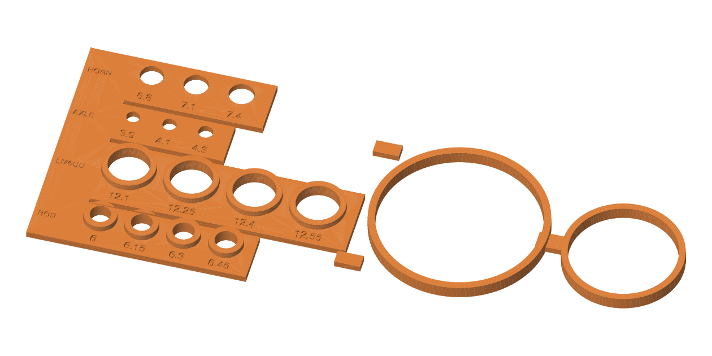

# Tolerance gauge: bearings + claw (one piece, ~1 h 20)

**Print:** open `tolerance_gauge.3mf` in PrusaSlicer (Ctrl+O, "Yes" to load its settings), slice, print.
One piece, ~1 h 20, ~11 g PETG, 0.2 mm layers, 2 walls, no supports, no brim. PETG at 235 °C / bed 80 °C
(your filament's range: 220–250 °C / 70–80 °C). Watch the first layers, then it's a simple flat print.

The sizes are engraved under each hole (mm). They start a little bigger than the robot's current sizes
on purpose, because the first prints came out too tight.

| Row / piece | Sizes | Test with | Tell me |
|---|---|---|---|
| **ROD** | 6.0 · 6.15 · 6.3 · 6.45 | 6 mm steel rod | smallest hole it **presses** into by hand, and the one it **slides** through |
| **LM6UU** | 12.1 · 12.25 · 12.4 · 12.55 | an LM6UU | smallest hole it **presses** into (thumbs / vise) |
| **AXLE** | 3.9 · 4.1 · 4.3 | a #6-32 screw | smallest hole it **turns freely** in (claw axle, link pivot) |
| **HORN** | 6.8 · 7.1 · 7.4 | SG90 round horn, arms cut off (hub only) | the hole the hub **presses** into snugly |
| **Ring** (big) | 47.25 | the 6807 bearing's outside | does it press in? too tight / snug / loose |
| **Post** (round) | 34.80 | the 6807 bearing's hole | does the bearing press on? too tight / snug / loose |

**Calipers:** measure every hole (twice, 90° apart), the ring's inside, the post's outside, and the gauge's
overall length (180.9 mm in the CAD). With these numbers every hole and shaft in the CAD gets corrected
together, and only the parts that need it get reprinted.

The claw's gear mesh is checked on the real fingers; looser / tighter finger pairs are in `../stl/finger_variants/`.
The replacement lift link with the 2.4 mm crank hole comes with the corrected parts.
