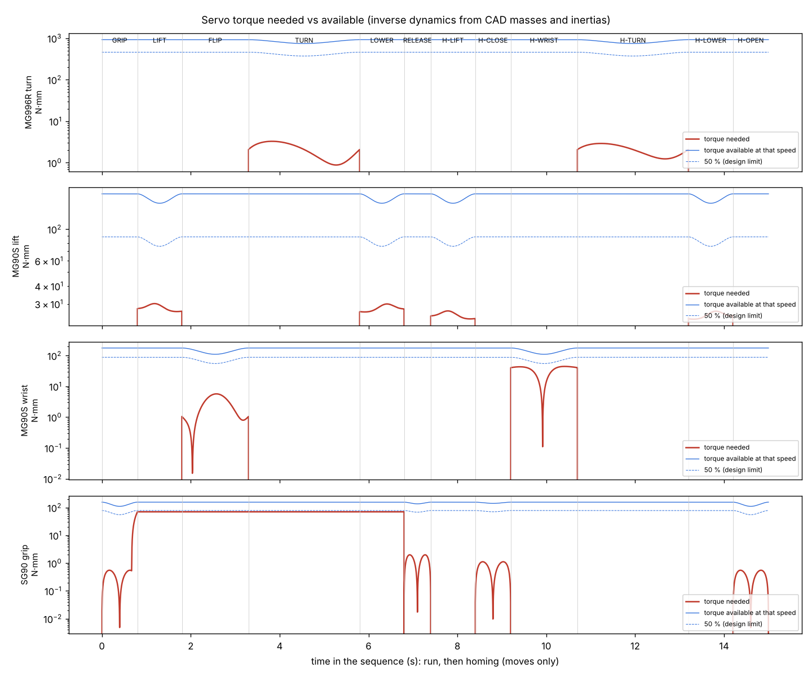

# Detail Design: Concept A (printable-level CAD + motion check)

Source: `cad/`. Wiring: `04_wiring.md`. BOM: `05_bom.md`. One Python model (`model.py`) holds every part, its material and
the robot's kinematics. The collision check, the STEP/STL exports, the Fusion 360 script and the
3D page (`viewer/concept_a_detail.html`) all use that same model.

```bash
python3.13 backend/cad/check.py    # motion + collision + mass + loads -> out/check_report.txt
python3.13 backend/cad/export.py   # STEP assembly, per-part STEP/STL, viewer + Fusion data
python3 backend/tools/build_detail_viewer.py        # rebuild the 3D page
```
(`pip install cadquery`; CadQuery needs Python ≥ 3.10.)

## What changed from the PDR concept, and why

Running the real part shapes through the firmware sequence found problems that the block model
missed. Each fix below closes a problem the check found.

| Problem found | Fix |
|---|---|
| The turntable stack (servo + bearing + plate, ~59 mm) is as tall as the grip axis (59.7 mm), so the wrist servo hanging below the arm drove into the turret plate and the lazy-susan | Replaced the 4 in lazy-susan with a **6807-2RS bearing (35 × 47 × 7 mm)** in a **28 mm tower**. The turret plate is now a **"D"** that stops 22 mm in front of the axis |
| The square base corner reached the can's path, so the inverted can and the flipped gripper hit the base during the 90° turn | The base is **cut away in the 175° sector the arm, the open arms and the can sweep** (−30° … 145°). Only the bearing tower stays there |
| The MG996R body sat under the arm's path | The servo now points **away from the sweep** (225°) |
| The open gripper arms hit the gripper-frame posts | Posts moved inside the arms' swing (x = ±15 mm) |
| At the target the gripper is upside down, so opening fully (75°) swung an arm down into the base | **Release opens only 25°** (`GRIP_RELEASE = 70`). That's enough: the pads swing 13.3 mm clear of the can (11.7 mm with the 1.6 mm silicone liners) |
| Turning back with the can at the target sweeps the gripper through it | Homing only after the can is lifted off (the button press), as before |
| Un-flipping with the arms open sweeps them through the table | Homing order: **lift → close → un-flip → turn → lower → open** (firmware updated) |
| The turret hub sat at 0.0 mm on the MG996R body (rubbing) | Hub raised 0.6 mm |
| Pads touched the can 6–26 mm above its middle (the voted design grips the middle) | Pads made 40 mm tall (z 46–86 mm), so they cover the middle of the can |
| The can is a standard Coke can (66.2 × 122.2 mm, tapered top and bottom), not a generic 2.4 × 4.7 in cylinder | Grip axis raised to 61.1 mm (mid-height); finger pivots moved to y = 83 mm and the plates trimmed; carriage and lift servo up 2 mm; can bumper narrowed so it stays ≥ 0.5 mm from the closed fingers |
| Routing the wires in 3D (`docs/10_wiring_3d.md`): the START button and DC jack are ~16 mm deep behind the panel, but the buck sat only 7 mm behind it | **Buck moved 12 mm back, breadboard 4 mm back**; button, LED, jack and the 1000 µF capacitor added to the CAD. The gripper lead with its three loops is 516 mm, so its extension is **500 mm** |
| One MG996R mounting block rose into the turret hub | Block shortened to stop 1 mm under the hub |
| The claw's gears were plain pitch-circle discs: printed like that, the right arm wouldn't follow the left | **Real involute gears**: 16 teeth, module 1, 20°, profile shift +0.1 each (16 teeth is under the 17-tooth undercut limit; the shift also fits the 16.2 mm pivots), 0.2 mm backlash. CAD: no overlap and a constant 0.1 mm flank gap over the full 75° |
| The real gear teeth reached the 9 mm can bumper | Bumper narrowed to 5 mm: tooth tips clear it by 0.67 mm |
| The sweep cut left two sharp tips on the base with no function | Tips chamfered (30 mm / 15 mm, the right one limited by the ballast pocket) with a wall on the new faces; tip-over margin 39 → 37 mm, 7 g of PETG saved |
| Power: is the buck needed? A 5 V adapter wired straight to the servos and the Uno was simulated against 12 V + buck | **Buck kept** (set to 5.8 V): with a servo stalled, the 5 V direct design drops the Uno to 4.43 V and the servos to 4.25 V; with the buck they hold 5.00 V and 5.50 V (`EE/README.md`). The MG996R's power goes straight to the buck terminals |

## Final check (`out/check_report.txt`)

| Check | Result |
|---|---|
| Part-to-part collisions, 289 poses (every 7°/0.6 mm), solid booleans | **PASS**: none |
| Anything moving below the table | **PASS**: lowest is the gripper servo, 17 mm up |
| Can at the end | **PASS**: centre (127.0, 0.0) mm, inverted, 0.0° tilt, set down at z = 0 |
| Pads | Touching the can at the end of GRIP (the servo then squeezes past contact); 13.3 mm clear after release. The gear teeth stay ≥ 2.5 mm from the can in every pose |
| Tightest running gaps | 0.5 mm finger ↔ gripper plates (designed); 0.5 mm can ↔ bumper and bumper ↔ closed fingers (designed). LM6UU on rods is a sliding fit |
| Tip-over | **PASS**: the robot CG stays ≥ 37 mm inside the base + tray footprint in every pose |
| Lift slides freely | **PASS**: jam ratio 0.018 with LM6UU; a printed slide would be 0.55 |
| Servo margins (CAD masses) | Lift 5×, wrist 30×, turntable ≫ (weight on the bearing) |
| Mass | ≈ 564 g robot (≈ 294 g PETG printed, 270 g purchased) |

## Engineering checks (`cad/check/mech_report.txt`)

`backend/mech/mech_checks.py` takes the real mass, centre of gravity and inertia of every CAD part
and the firmware's move times, and checks every mechanism against a stated limit.
**43 checks, 43 PASS.** The tightest of each kind:

| Area | Tightest result | Limit |
|---|---|---|
| Servo torque (inverse dynamics, ratings at 4.8 V) | SG90 gripper at 45 % of the torque available (closing + squeeze); lift 20 %, wrist 32 %, turntable 1 % | ≤ 50 % |
| Servo speed | wrist at 38 % of no-load speed | ≤ 70 % |
| Lift slider-crank (exact) | stroke 15.31 mm; link tilts up to 12.3°; link clears its neighbours by 0.85 mm in its real tilted pose; the model's lift height is within 0.20 mm of the exact value | ≥ 15.2 mm, ≤ 30°, ≥ 0.5 mm |
| Gears | contact ratio 1.44; tip 0.51 mm thick; Lewis bending 10.8 MPa even at SG90 stall | ≥ 1.2, ≥ 0.4 mm, ≤ 20 MPa |
| Can | 0.8 N squeeze = 5.4× the minimum through every acceleration; the SG90 can't exceed 1.78 N/arm (dent ~8 N); set down at 0.00 mm; inverted can tips only past 24.3° | ≥ 2×, < 8 N, ≥ 9° |
| Stability | dynamic tip-over (zero-moment point, all moves) 36.7 mm inside; sliding 1.1 % and turning reaction 2.4 % of foot friction | ≥ 20 mm, ≤ 20 % |
| Strength / stiffness | finger arm 3.8 MPa and 0.71 mm at SG90 stall; everything else < 1 MPa; screws 615 N pull-out vs 19 N worst load | ≤ 20 MPa (PETG UTS 50 / 2.5) |
| Power / heat | 0.65 A peak (5 A buck); buck 0.42 W, Uno regulator 0.35 W, SG90 holding 1.7 W for 5 s | ≤ 50 % rating, ≤ 1 W, ≤ 2 W |



## 3D-print tolerances (PETG, 0.4 mm nozzle)

All holes are generated from the `TOL` table in `model.py`. **Print `tolerance_coupon.stl`
first** (6 holes, labelled in the part note) and adjust `TOL` if a fit is off.

| Fit | Size (mm) | Where |
|---|---|---|
| #6-32 clearance / pilot | 3.9 / 2.9 | Most joints. Screws cut their own thread (no nuts in the kit) |
| #8-32 pilot | 3.5 | MG996R flange into the base |
| Servo-bag screw pilot | 1.7 | Servo tabs and horns |
| 6 mm rod press | 6.00 | Blind holes in the turret plate and top cap capture the rods |
| LM6UU press | 12.15 | 4 pockets in the carriage, 43 mm apart per rod |
| 6807 housing / hub | 47.10 / 34.95 | Outer race in the tower; printed hub in the bore |
| Running clearance | ≥ 0.5 | Finger arms between the gripper plates |
| Gear backlash | 0.2 | Involute 16T m1 20° gears, profile shift +0.1, each tooth thinned 0.1 mm; centre distance 16.2 mm (CAD: 0.1 mm flank gap over the whole travel) |

## Fasteners: Harbor Freight 57-pc machine-screw kit #67675

The kit has pan-head Phillips screws only, with **no nuts**, so every screw threads into a
printed pilot hole.

| Screw | Used | Where |
|---|---|---|
| #6-32 × ½″ (12 in kit) | 8 | Tray → base 2, spine → turret 2, top cap → spine 2, link pivot 1, right gear axle 1 |
| #8-32 × ½″ (10 in kit) | 4 | MG996R flange → base |
| Servo-bag screws | ~14 | Servo tabs 2 × 3, horn → turret 4, horn → gripper flange 4, crank → link 1. A small M2 self-tapping pack covers any shortfall |
| None (press fit) | — | 2 rods, 4 LM6UU, 6807 bearing, turret hub |
| Glue | — | Silicone pad liners and can bumper. The Uno sits on printed pegs (the Uno's 3.2 mm holes are too small for #6) |

## Parts (printed in PETG unless noted)

`base` (bearing tower, servo pocket, ballast pockets) · `electronics_tray` (Uno,
breadboard, button/LED/DC-jack panel) · `turret_plate` (D plate + hub + rod bosses) · `spine`
(column back + lift-servo bracket) · `top_cap` · `carriage_arm` (carriage + arm + wrist bracket,
one print) · `lift_link` · `gripper_frame` (flange + 2 plates + posts) · `finger_L`, `finger_R`
(gear + arm + pad) · `can_bumper` (silicone sheet) · `tolerance_coupon`.

## Simulating it in Fusion 360 and SolidWorks

- **STEP:** `cad/step/concept_a_assembly.step` opens in both. It has one
  component per moving group: `grp_fixed`, `grp_turret`, `grp_crank`, `grp_lift`, `grp_wrist`,
  `grp_finger_L`, `grp_finger_R`, `grp_can`.
- **Fusion 360:** run the script `backend/cad/fusion_animate/`. It imports the STEP,
  plays the firmware sequence, and runs Fusion's own interference check at the end of every
  move. Its transforms match the model to 1e-14. It **has not been run inside Fusion yet**; if
  an API call fails, it reports which one.
- **SolidWorks:** open the STEP and mate the groups. The joints are listed in `cad/README.md`.

## Verify before printing

Purchased-part dimensions are typical datasheet values: **measure your parts** and edit `P` in
`model.py`, then rerun `check.py`.
- MG996R body and flange
- Micro servo body and tabs
- 6807 bearing
- The can: modelled as a standard 12 oz Coke can (66.2 mm × 122.2 mm, 15 g empty)
