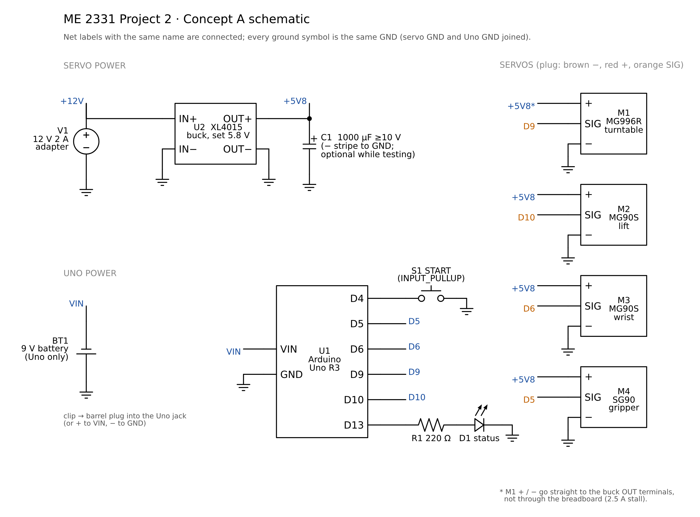

# Wiring: Concept A


`docs/wiring/wiring_diagram.svg` (vector) and `.png` are generated by
`python3 backend/tools/make_wiring_diagram.py`. The drawing uses the breadboard style of
**Fritzing**, which is what hobbyists usually use for Arduino wiring diagrams. To try the same
circuit live, use **Wokwi** (`wokwi/concept_a/`) or **Tinkercad Circuits**
(`docs/tinkercad_concept_a.md`). Both run the real sketch.

There are no optional parts: 4 servos, 1 START button, 1 status LED, 1 power adapter, 1 buck converter.

## Schematic (standard symbols)



`docs/wiring/schematic.svg` / `.png`, drawn by `python3.13 backend/ee/schematic.py`. Net labels with the
same name are connected; every ground symbol is the same GND.

## Power: Uno on its own 9 V battery, servos on 12 V adapter + buck

```
9 V battery ──> Uno barrel jack (or + → VIN, − → GND)        the Uno only (~59 mA, ~9 h per battery)

12 V 2 A adapter ──> DC jack / LIZVOR terminal-block tip
 └── XL4015 buck, set to 5.8 V with a meter before any servo is connected
      ├── OUT terminals ──> MG996R + / −  (straight to the terminals: its 2.5 A stall skips the breadboard)
      └── breadboard servo rail ──> lift, wrist, gripper servos (+ 1000 µF capacitor)
All grounds are joined: battery − (through the Uno), Uno GND, buck −, rail GND.
```

**Why the Uno gets its own battery:** it no longer shares a supply with the servos, so a stalled
servo can't reset it, and the Uno can be flashed and tested on USB or the battery with the servo power
off. Simulated in ngspice (`backend/ee/power_final.py`, `EE/out/power_final_report.txt`): the Uno stays
at 5.00 V (4.92 V with a nearly flat 7.2 V battery) in a normal run, with the MG996R stalled and at power-up.
The adapter now only feeds the servos: 0.32 A in a normal run, 1.69 A worst case (stall), under its 2 A.

**The ground link is not optional.** Uno GND must be wired to the servo rail GND. Without it the servo
signals have no reference and the servos twitch or do nothing.

**The 1000 µF capacitor:** fine to leave out while testing. The buck board has its own ~220 µF output
capacitor, and the firmware attaches the servos 0.3 s apart and moves one at a time. In the worst case
(all four servos starting within 0.6 ms), the simulation shows the servo supply dipping to 4.65 V and
ringing to 6.6 V without it, against 5.11 V and 6.15 V with it. Fit it (≥ 470 µF, ≥ 10 V, stripe to GND)
before the final runs.

**Flashing the code:** always possible over USB, whatever else is connected. With the 9 V battery
plugged in too, the Uno switches USB power off by itself (above 6.6 V on VIN). The servos only move if
the 12 V adapter is on.

**Do we need the buck? Yes.** Both designs were simulated in ngspice with the real servo
currents, in a normal run, with the MG996R stalled (arm blocked), and at power-up away from
home (`EE/README.md`, section 6):

| | **12 V + buck (selected)** | 5 V 4 A adapter, no buck |
|---|---|---|
| Normal run | Uno 5.00 V, servos ≥ 5.72 V | Uno 4.86 V, servos ≥ 4.82 V |
| MG996R stalled 0.5 s | **Uno 5.00 V**, servos ≥ 5.50 V | Uno **4.43 V** (below its 4.5 V / 16 MHz minimum), servos 4.25 V |
| Power-up away from home | Uno 5.00 V, servos ≥ 5.52 V | servos 4.34 V |
| USB plugged in while powered | Fine: the Uno switches USB power off above 6.6 V on VIN | Not allowed: two 5 V sources fight, so no Serial Monitor while calibrating |
| Parts | adapter $8 + buck $5, set once with a meter | adapter $9 |

Both pass the normal run. The buck wins on every fault case and lets the Serial Monitor stay open
while you calibrate the angles. That is worth $5 and one adjustment. Power decision matrix:
12 V + buck **7/9**, 5 V direct 6/9, LiPo + buck 5/9, 9 V battery 4/9, AA NiMH pack 4/9
(`docs/decision_matrix_and_bom.xlsx`, sheet *Power source*).

Why 5.8 V and not 6.0 V: the MG90S and SG90 are rated to 6.0 V, and 5.8 V leaves room for the
buck's adjustment screw to drift.

**A 9 V battery can't run the servos.** A PP3 gives about 0.5–1 A; one servo stall needs 2.5 A, so it
would sag. That's why the 9 V battery powers **only the Uno** (59 mA).

The firmware attaches the servos 0.3 s apart. If the robot is powered up away from home, only one
servo jumps at a time. All four at once would pull 4.8 A, over the 12 V adapter's limit.

## Wire list (matches `firmware/concept_a/concept_a.ino`)

| From | To | Wire | Notes |
|---|---|---|---|
| 9 V battery + | Uno barrel jack + (or **VIN**) | red | Uno power only. Snap clip with a 5.5 × 2.1 mm plug |
| 9 V battery − | Uno barrel jack − (or **GND**) | black | |
| 12 V jack + | XL4015 IN+ | red | Servo power only. "Jack" = the DC panel jack or the LIZVOR terminal-block tip |
| 12 V jack − | XL4015 IN− | black | |
| XL4015 OUT+ / OUT− | servo rail + / GND, and the MG996R's red / brown | red / black | 5.8 V. MG996R power on the terminals, not the breadboard |
| 1000 µF capacitor | across the servo rail, stripe (−) to GND | — | Optional while testing; fit before the final runs |
| GND rail | Uno GND | black | **common ground: required** (the servo signals need it) |
| Turntable servo MG996R | signal → **D9** (+ / − at the buck terminals) | orange | One extension lead is cut to split its power from its signal |
| Lift servo MG90S | signal → **D10** | orange | 300 mm extension lead |
| Wrist servo MG90S | signal → **D6** | orange | 300 mm lead. Code widens its pulse range to 500–2500 µs to reach 180° |
| Gripper servo SG90 | signal → **D5** | orange | 500 mm extension lead (or a taped jumper chain, see 11_bom) |
| START button (12 mm) | **D4** → button → GND | green / black | `INPUT_PULLUP`, debounced in code |
| Status LED | **D13** → 220 Ω → LED → GND | yellow / black | off = idle, blinking = moving, on = done |

The Servo library works on any pin. It disables `analogWrite` on D9/D10, which this design
doesn't need. The lift, wrist and gripper servos ride on the moving column, so their leads go
through the spine with a loose loop for the 90° turn and the 15 mm lift.

**Why a physical button?** The spec allows one start and then no human input. A button is one
wire on one pin with nothing to pair or charge. An IR remote would add a receiver, a library and a
battery, and stray IR could start it. A timer start couldn't be controlled at the demo.
