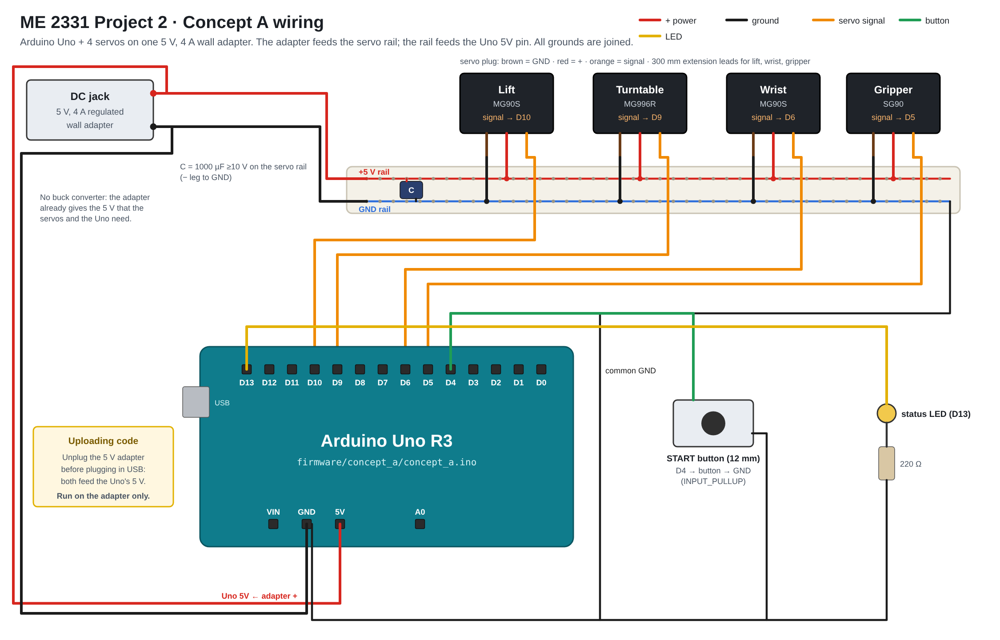

# Wiring: Concept A



`docs/wiring/wiring_diagram.svg` (vector) and `.png` are generated by
`python3 tools/make_wiring_diagram.py`. The drawing uses the breadboard style of
**Fritzing**, which is what hobbyists usually use for Arduino wiring diagrams. To try the same
circuit live, use **Wokwi** (`wokwi/concept_a/`) or **Tinkercad Circuits**
(`docs/tinkercad_concept_a.md`). Both run the real sketch.

There are no optional parts: 4 servos, 1 START button, 1 status LED, 1 power adapter.

## Power: one 5 V, 4 A wall adapter, no regulator

```
5 V 4 A regulated wall adapter ──> DC panel jack
 └── +5 V / GND rails on the mini breadboard
      ├── all 4 servo red (+) and brown (GND) wires
      ├── 1000 µF capacitor across the rails (− leg to GND)
      └── Uno 5V pin and GND
```

**Why this and not a battery?** Full scoring: `docs/decision_matrix_and_bom.xlsx`, sheet
*Power source* (also `docs/decision_matrix_power.csv`).

| Option | Score (of 9) | Deciding fact |
|---|:-:|---|
| **5 V 4 A wall adapter, direct (selected)** | **8** | Covers a 2.5 A MG996R stall; one plug; servos are rated 4.8–6 V, so no regulator; nothing to charge or set |
| 12 V wall adapter + XL4015 buck (old design) | 5 | Works, but adds a board whose output must be set with a meter before the servos go on |
| 4×AA NiMH (servos) + 9 V (Uno) | 5 | Two packs to keep charged; needs a charger |
| 9 V battery (PP3) + buck | 4 | A PP3 gives only ~0.5–1 A. A 2.5 A servo stall sags it and resets the Uno. 9 V would also burn the servos without a regulator |
| 2S LiPo 7.4 V + buck | 3 | Needs a balance charger and fire-safe handling, plus the buck |

So wall power is the simpler, easier-to-maintain choice, and a 5 V adapter removes the buck as well.

**The one rule that comes with it:** the adapter feeds the Uno through its 5V pin, which has no
reverse protection. **Unplug the adapter before plugging in USB** to upload, and run on the
adapter only. (With both connected, two 5 V sources fight through the Uno.)

The electrical calculations behind this (servo PWM signals in firmware order, current per
step, rail voltage in ngspice, LED and button values, the LTspice circuit) are in
**[`EE/README.md`](../EE/README.md)**. Short version: peak 0.65 A in a normal run (6× margin on
4 A), and the Uno's 5V pin stays ≥ 4.86 V.

## Wire list (matches `firmware/concept_a/concept_a.ino`)

| From | To | Wire | Notes |
|---|---|---|---|
| Jack + | +5 V rail and Uno **5V** | red | |
| Jack − | GND rail and Uno **GND** | black | common ground (servo signals need it) |
| Turntable servo MG996R | signal → **D9**, + → rail, GND → rail | orange / red / brown | |
| Lift servo MG90S | signal → **D10** | orange | 300 mm extension lead |
| Wrist servo MG90S | signal → **D6** | orange | 300 mm lead. Code widens its pulse range to 500–2500 µs to reach 180° |
| Gripper servo SG90 | signal → **D5** | orange | 300 mm lead |
| START button (12 mm) | **D4** → button → GND | green / black | `INPUT_PULLUP`, debounced in code |
| Status LED | **D13** → 220 Ω → LED → GND | yellow / black | off = idle, blinking = moving, on = done |

The Servo library works on any pin. It disables `analogWrite` on D9/D10, which this design
doesn't need. The lift, wrist and gripper servos ride on the moving column, so their leads go
through the spine with a loose loop for the 90° turn and the 15 mm lift.

**Why a physical button?** The spec allows one start and then no human input. A button is one
wire on one pin with nothing to pair or charge. An IR remote would add a receiver, a library and a
battery, and stray IR could start it. A timer start couldn't be controlled at the demo.
