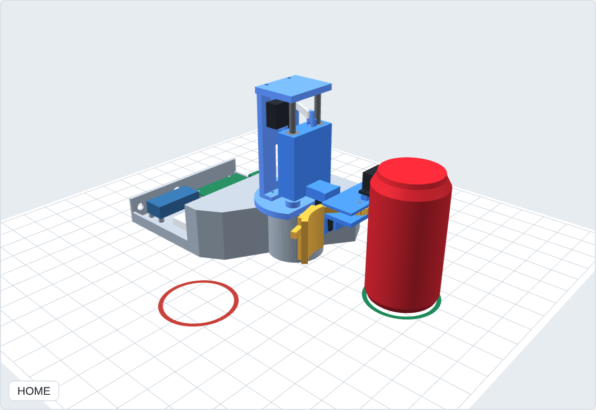
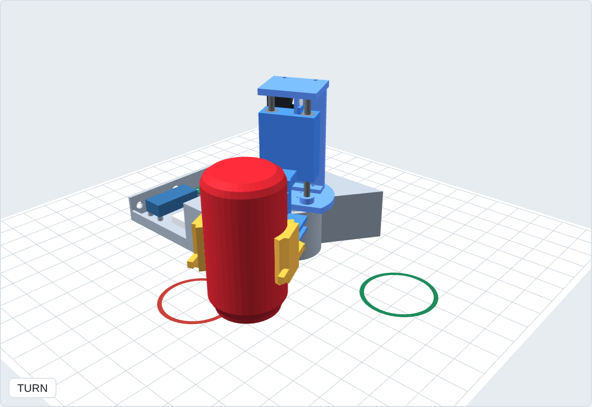
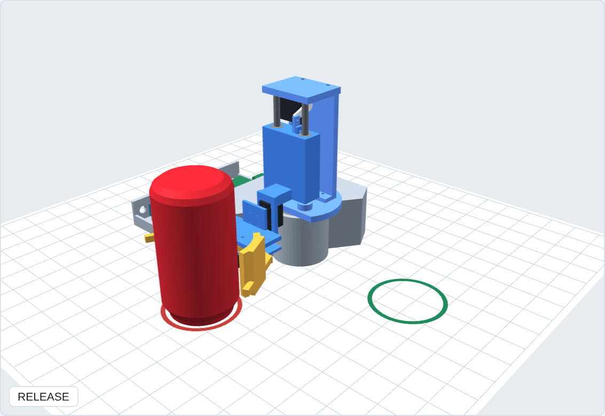

# How the motors and the claw work: Concept A

Four hobby servos, **one moving at a time**. Each servo holds an angle set by a pulse from the Uno
(see `EE/README.md` for the signals). Every move eases in and out (slow, fast, slow) so the light
can isn't shaken loose.

## The four motors

| # | Motor | Pin | Moves | Angles | Mechanism |
|---|---|---|---|---|---|
| 1 | **Turntable**: MG996R (9.4 kg·cm) | D9 | the whole arm, 90° around the robot | 135° (START) → 45° (TARGET) | Servo under the base turns the turret plate. The plate sits on a **6807 ball bearing**, which carries the weight and tipping load, so the servo only has to turn it |
| 2 | **Lift**: MG90S | D10 | the arm, 15.3 mm (0.6 in) straight up | 30° (down) → 75° (up) | Servo on the column turns a **20 mm crank**; a **link** pushes the carriage up two **6 mm rods** on 4 **LM6UU linear bearings** (they can't jam: jam ratio 0.018) |
| 3 | **Wrist**: MG90S | D6 | the gripper, a half-turn roll | 0° (upright) → 180° (flipped) | Servo on the arm rolls the gripper about the arm's line, which passes **through the can's centre**, so the can flips in place |
| 4 | **Gripper (claw)**: SG90 | D5 | both arms, open / close | 20° (open) → 95° (closed) → 70° (release) | See below |

## The claw

1. **One servo, two arms.** The SG90 turns the **left arm** directly: the left arm's gear sits on
   the servo's spline.
2. **Gears make it symmetric.** The left arm's **16-tooth gear** meshes with an identical gear on the
   **right arm**, which turns freely on a screw axle. Meshed gears turn opposite ways by the same
   angle, so both arms close together and **centre the can** automatically.
3. **Repeatable depth.** The can is placed against a silicone **bumper** in the middle of the gripper,
   so it sits at the same depth every time.
4. **Gentle squeeze.** Curved pads lined with silicone close on the can's middle. The servo is set
   just past contact, a squeeze of about **0.5–1 N per arm**: 0.39 N is enough to hold the 15 g can
   with a 3× margin, and it dents at about 8 N. (The SG90 can make at most 1.8 N per arm here.)
5. **Small release.** At the target the gripper is upside down, so the arms open only **25°**
   (95° → 70°). Opening fully would swing an arm into the base; 25° clears the can by about 2 mm.

## The sequence

| Step | Motor | What happens | Why |
|---|---|---|---|
| GRIP | 4 gripper | arms close on the can | — |
| LIFT | 2 lift | can rises 0.6 in | gripped at mid-height, the can's corner is 2.74 in from the grip point but only 2.41 in above the table: flipping in place would dig 0.33 in into the table. Lifted, it clears by 0.27 in |
| FLIP | 3 wrist | can turns upside down in place | rolling about the can's own centre |
| TURN | 1 turntable | arm swings 90° to TARGET, can stays 5 in out | the visible 90° move |
| LOWER | 2 lift | can comes down 0.6 in onto the table | flipped about its centre, so the same distance sets it exactly on the table |
| RELEASE | 4 gripper | arms open 25° | can stands free and inverted at TARGET |

Total 6.4 s. The status LED blinks while moving and stays on at DONE. **Homing** (lift, close the
arms, un-flip, turn back, lower, open) only starts after the can is lifted off and START is pressed
again, because the open arms straddle the can.

## See it in Fusion 360

Same 4 files as before: `cad/step/concept_a_assembly.step` + `cad/step/fusion_sequence.json` in one
folder, and `backend/cad/fusion_animate/fusion_animate.py` + `.manifest` in a folder named
`fusion_animate`. (Download `fusion_animate.py` again: the guided tour is new.)

1. **Shift + S** → select **fusion_animate** → **Run** → choose `concept_a_assembly.step`.
2. **"Guided tour?" → Yes.**
3. An overview box lists the 4 motors. Press **OK**.
4. Before each move a box says **which motor moves, from which angle to which, and why** (the text
   above). Press **OK** and watch that move play slowly. Repeat through RELEASE and homing.
5. At the end, **"Play again?"**: Yes replays without re-importing.

Answer **No** at step 2 for the full-speed run with Fusion's interference check (the version to
record for the demo video).

**Tip for showing the claw:** zoom in on the gripper before pressing OK on the GRIP step, and orbit
so you look down at the two arms. You'll see the gears turn opposite ways and both arms meet the can
at the same time.

On the browser page `viewer/concept_a_detail.html` the same motion can be scrubbed frame by frame
with the slider.
