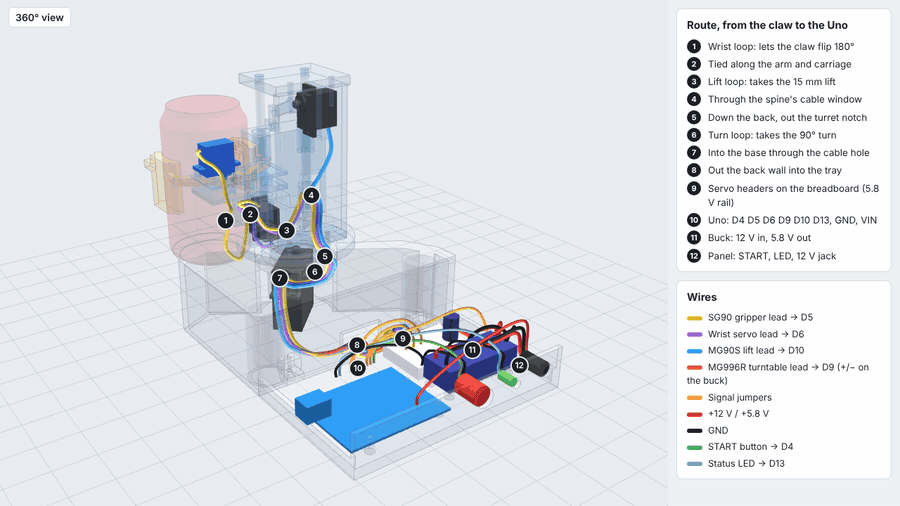
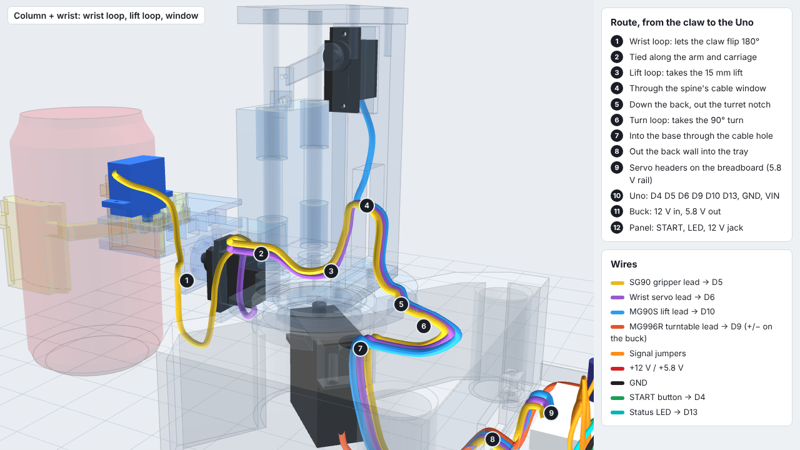
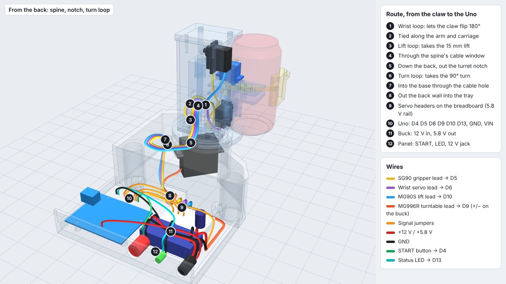
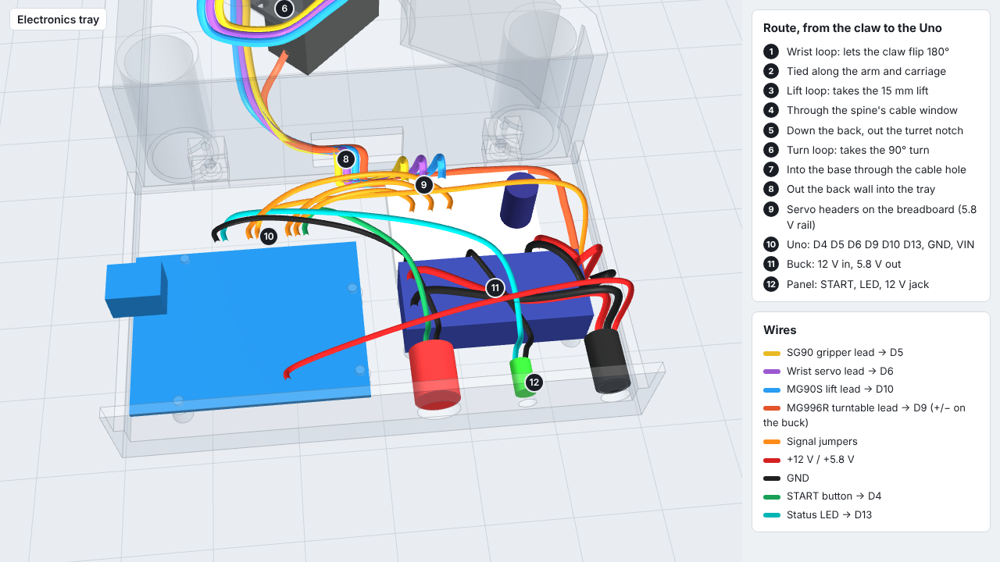
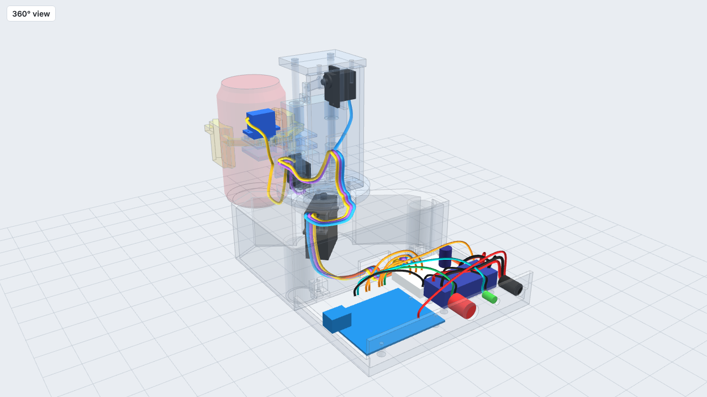

# Wire routing in 3D: Concept A

How every wire runs through the robot and where it is tucked in. The route is modelled in CAD and
checked against every part in six poses of the run (`cad/wiring/wiring_report.txt`: **all pass**).

**Interactive 360:** `viewer/wiring_360.html` (drag to orbit, **Legend** button hides the legend and number tags).
Videos: `docs/wiring/wiring_360.mp4` / `.gif` (with legend) and `wiring_360_clean.mp4` / `.gif` (no legend).



## The route, from the claw to the Uno

| # | Where | What it does |
|---|---|---|
| 1 | **Wrist loop** | SG90 lead is tied to the side of the wrist flange, hangs in a loop left of the wrist servo and is tied again to the bracket. Both tie points sit close to the roll axis (r 13–16 mm), so a 69 mm loop covers the 180° flip (needs 48 mm, 1.45×) |
| 2 | **Arm and carriage** | SG90 + wrist leads tied along the left side of the arm beam, then around the carriage's left side |
| 3 | **Lift loop** | U-loop in the gap between carriage and spine: 52–54 mm for the 15.3 mm lift (≥ 1.42×) |
| 4 | **Spine cable window** | All three column leads (lift lead joins here) pass through the window in the spine's back wall |
| 5 | **Turret notch** | Down the back of the spine, over the plate and out through the notch at the plate's back edge |
| 6 | **Turn loop** | Loop on the base top, outside the turret (r > 41 mm) and outside the 175° sweep. The base hole is at 225°, half-way between the notch at START (270°) and TARGET (180°), so the loop only has to cover 45° each way: 67–87 mm for 45–50 mm needed (≥ 1.34×) |
| 7 | **Base cable hole** | Down into the base, along the floor; the MG996R lead joins here |
| 8 | **Base exit** | Out through the back wall into the tray |
| 9 | **Servo headers** | Each servo plugs onto a 3-pin header on the breadboard (5.8 V servo rail + 1000 µF) |
| 10 | **Uno** | Signal jumpers to D5 (grip), D6 (wrist), D9 (turn), D10 (lift); button D4; LED D13; GND to the rail; 12 V to VIN |
| 11 | **Buck** | 12 V in from the jack; 5.8 V out to the rail and directly to the MG996R + / − |
| 12 | **Panel** | START button, status LED, 12 V jack. Their wires go straight up out of the lugs and over the buck |

Ties: small zip ties on adhesive mounts (BOM) at the wrist flange, bracket, arm beam, carriage side,
back of the spine, base floor and tray floor. **The three loops stay free.**

## Lead lengths

| Lead | Route | Buy |
|---|---|---|
| SG90 gripper | 516 mm | 250 mm stock + **500 mm** extension |
| Wrist (MG90S) | 416 mm | 250 + 300 mm |
| Lift (MG90S) | 345 mm | 250 + 300 mm |
| MG996R | 191 mm | 300 mm stock; one 300 mm extension cut to split + / − to the buck |

Stock lengths are the usual 250 / 300 mm: **check them on the servos you get.** Coil the spare in the tray.

## What the routing check changed

- **Buck moved 12 mm back, breadboard 4 mm back.** The 12 mm START button and the DC jack sit about
  16 mm deep behind the panel (body + solder lugs) but the buck was only 7 mm behind it. Now it's 19 mm,
  leaving 3 mm for the wires to go up. The button, LED, jack and the 1000 µF capacitor are now parts in the CAD.
- **Gripper extension is 500 mm** (was 300): with its three loops the gripper lead is 516 mm long.

## Views

| | |
|---|---|
|  |  |
|  |  |

## Regenerating

```bash
python3.13 backend/cad/wiring.py          # routes + checks + STEP (cad/wiring/)
node backend/tools/render_wiring_360.js   # viewer/wiring_360.html + docs/wiring/ videos and stills
```

Open `cad/wiring/wiring_harness.step` together with `cad/step/concept_a_assembly.step` (same origin) to see
the wires in SolidWorks or Fusion.
