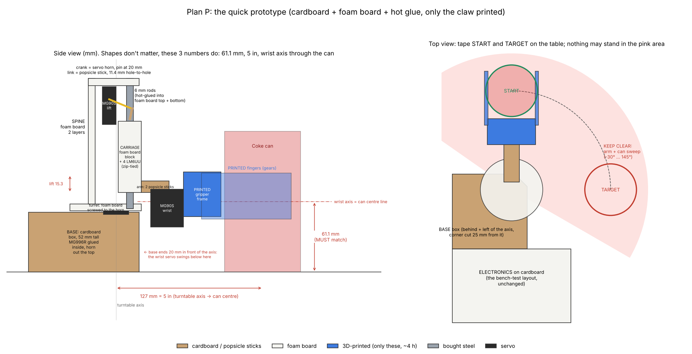

# Plan P: quick prototype (when the 3D printer can't be trusted yet)

**Goal:** prove in 1–2 days that the **electronics and every motion** work with the real servos, the
real can and the real dimensions, without waiting on (or failing) ~38 h of printing. Everything except
the claw is cardboard, foam board, popsicle sticks and hot glue. Only the claw is printed: its two
fingers mesh through gears, and that can't be faked with cardboard.

**Three numbers matter; everything else can be any shape:**
1. **Grip height 61.1 mm** from the table to the wrist axis (the can's middle).
2. **127 mm (5 in)** from the turntable axis to the can's centre.
3. The **wrist axis runs through the can's centre** (so the can flips in place).

And one rule: nothing may stand in the arm's sweep (the pink area: −30° to 145°). The base box stays
behind and left of the turntable axis, with its corner cut so it stays within 25 mm of the axis.

## What to print (only this, ~7 h, two short prints)

| File (`cad/print/plates/`) | Parts | PrusaSlicer estimate |
|---|---|---|
| `planP_1_claw.3mf` | gripper frame + right finger | ~3.9 h |
| `planP_2_finger.3mf` | left finger + tolerance coupon | ~3.3 h |

Short, small prints near the bed centre are the ones an unreliable printer gets right. The supports and the
100 % finger infill are already in the files. If even these fail, see "No-print claw" below.

## Materials (household / dollar store)

| Item | Used for |
|---|---|
| Cardboard box, ≥ 52 mm tall (shoe box, delivery box) | base with the MG996R inside |
| Foam board, 2 sheets (5 mm) | turret disc, spine, rod plates, carriage block |
| Popsicle sticks / craft sticks | arm, lift link |
| Hot glue, zip ties, double-sided tape | everything |
| Servo screws, #6 screws (have) | horns, turret onto the horn |
| Ruler, box cutter, marker, painter's tape | building, START / TARGET marks |
| Bought parts: 4 servos, 6 mm rods + LM6UU, electronics | the real ones (the bearing 6807 is not needed for Plan P) |

## Stages (do them in order, each one has a pass test)

| Stage | Build | Test (servo_setup or the main sketch) | Pass |
|---|---|---|---|
| **P0 Electronics** | Everything on the table: `13_electronics_bench_test.md` | bench_test, tests 1–5 | No resets, wrist reaches 180°, rail > 5.5 V |
| **P1 Claw** | Printed frame + fingers + SG90 (2 servo screws), right finger on its #6 axle | `g 20` / `g 95` with the can between the pads | Both arms close together, can held when you shake it and turn it upside down by hand |
| **P2 Wrist** | Wrist MG90S hot-glued to a foam block so its shaft is **61.1 mm** above the table; claw flange on its horn | `w 0` / `w 180` holding the can | Can flips in place, not dropped, no buzzing |
| **P3 Lift** | Two foam-board plates (bottom + top, 112 mm apart) with the rods glued in, 34 mm apart. Carriage: foam block, 4 LM6UU zip-tied + glued. Lift servo on the spine, crank = horn with a hole at **20 mm**, link = popsicle stick with holes **11.4 mm** apart | `l 30` / `l 75` | Carriage rises **15 mm** smoothly and comes back, no sticking |
| **P4 Turntable** | MG996R glued in the box, horn out the top, foam-board disc (r 40 mm) screwed to the horn | `t 135` / `t 45` with the column on it | Turns exactly 90°, column wobbles < 3 mm |
| **P5 Whole robot** | Column on the disc, arm (2 popsicle sticks) from the carriage to the wrist. Check 61.1 mm and 127 mm with the ruler. Tape START and TARGET | Upload `concept_a`, press START | Can ends **upside down at TARGET, standing**, 3 runs out of 5 |

If a stage fails, fix it there before building the next: each one is independent.

## No-print claw (only if the printer can't do even the two small prints)

SG90 horn with a popsicle stick hot-glued on as one finger, a second stick glued fixed opposite it, both
with a strip of rubber band as a pad, 66 mm apart minus the squeeze. One moving finger instead of two
geared ones: it proves the grip, the flip and the whole sequence, but not the gear mesh.

## What Plan P proves, and what it doesn't

| Proves | Doesn't prove |
|---|---|
| Electronics and power under real loads | Printed tolerances (press fits, holes): that's the coupon's job |
| Every servo angle and direction; the firmware sequence end to end | Stiffness of the printed parts (foam bends more than PETG) |
| Grip, flip, lift clearance, 90° turn and landing with the real can | Long-term wear |
| Wire lengths and the 3 service loops (route them the real way) | The 6807 bearing (Plan P sits the disc on the servo horn) |
| The calibration angles: **write them down**, they carry over to the printed robot | |

## After Plan P

1. Copy the calibrated angles into `firmware/concept_a/concept_a.ino`.
2. Fix the printer (`15_cr6se_print_troubleshooting.md`) and print the tolerance coupon.
3. Print the real parts plate by plate (`plate0` … `plate3`), and swap them into the working Plan P one
   module at a time: claw (already printed) → carriage + arm → column → base. The robot keeps working
   at every swap.

## Time

| | Time |
|---|---|
| P0 electronics | 1–2 h |
| Printing the claw (runs in parallel) | ~7 h |
| P1–P4 modules | 3–4 h |
| P5 integration + calibration | 2–3 h |
| **Total** | **about 1 day of work + 1 night of printing** |
