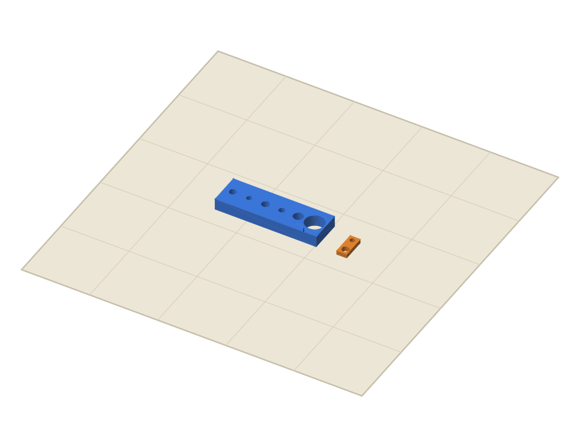
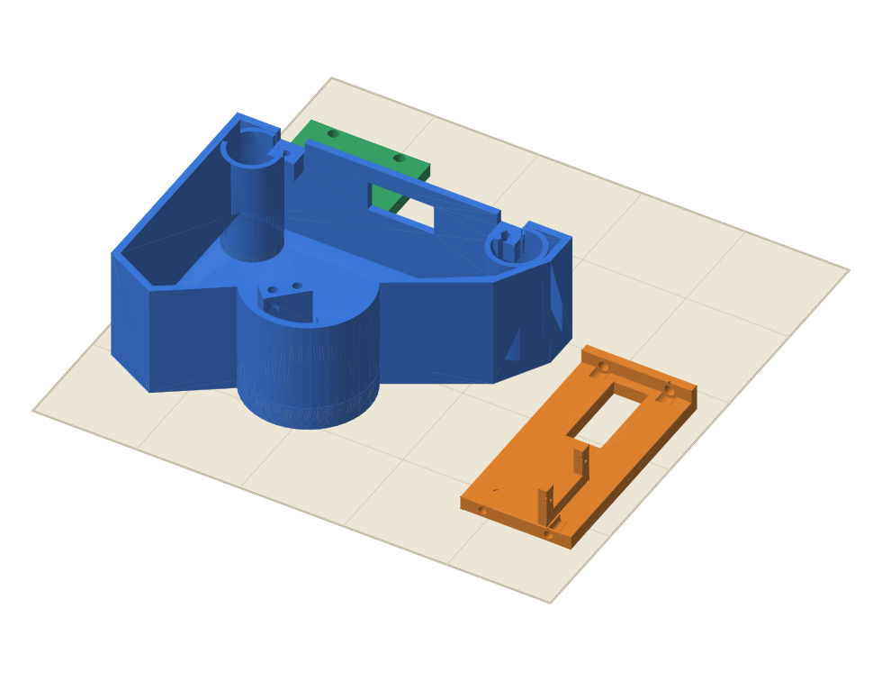
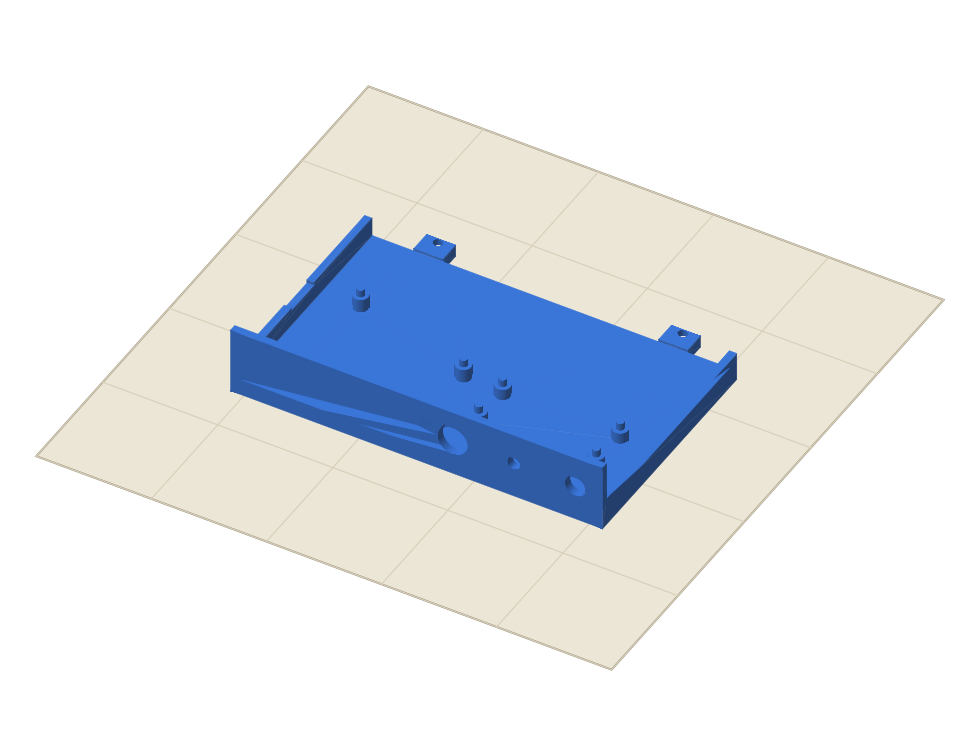
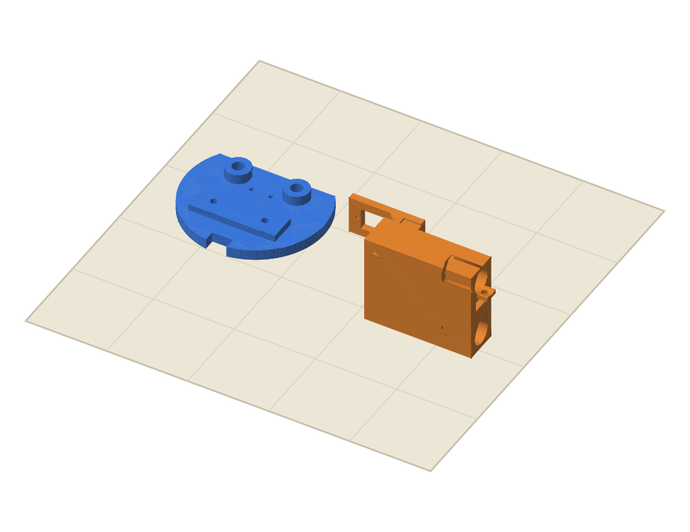
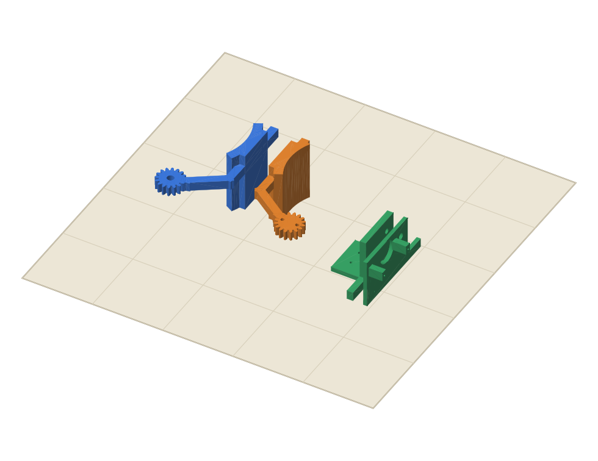

# Economy printing: only the quality each part needs (set up by hand)

Not every part needs the same settings. The base is a big hidden box: coarse layers and low infill are fine. The finger gears must mesh: they get slow, accurate outer walls. We accept small flaws on the rough parts and fix the few fits that matter with sandpaper, a drill or a knife (fix-up table at the end).

The pictures show each plate as it sits on the bed: put the parts on the bed the same way.

**No settings file and no changed 3D files:** import the unchanged STLs from `cad/print/stl/` (already turned to their best side: don't rotate them, except flat on the bed) and type the numbers below into your slicer. The parts are grouped so that **each plate uses one setting for the whole plate**: nothing to set per part.

**Result (every plate sliced): 36 h 43 → 23 h 39 of printing (−36 %), 380 g → 332 g of PETG (−13 %).** Less heating time = less energy.

## Same on every plate

| Setting | Value |
|---|---|
| Nozzle temperature | 235 °C (first layer 238 °C, never above 240 °C: PTFE-lined hotend) |
| Bed | Textured PEI sheet, 80 °C. **No glue.** Clean it with dish soap + water (or isopropyl) and don't touch the print area |
| Z-offset | a little higher than for PLA: PETG must not be squished into PEI (it can stick too hard) |
| Removing parts | let the bed cool to room temperature, take the sheet off and flex it: parts pop off |
| First layer | 0.24 mm high, 20 mm/s |
| Line width | 0.42 mm (0.4 mm nozzle) |
| Cooling fan | 30 %, off for the first 3 layers |
| Retraction | 5 mm at 40 mm/s (Bowden) |
| Solid / top infill speed | 40 / 30 mm/s |
| Travel speed | 150 mm/s |
| Max flow | keep under 8 mm³/s (stock CR-6 SE hotend): the speeds below already do |
| Elephant-foot compensation | 0.15 mm (Cura: initial layer horizontal expansion −0.15) |
| Seam | rear / aligned |
| Skirt | 2 loops (unless the plate says brim) |

## The plates

| Plate | Parts (STL in cad/print/stl) | Layer | Walls | Top / bottom | Infill | Speeds outer / inner / infill (mm/s) | Supports | Adhesion | Time | PETG |
|---|---|---|---|---|---|---|---|---|---|---|
| **A  Coupon + lift link** (STANDARD) | CA-900 Tolerance coupon, CA-302 Lift link | 0.2 mm | 3 | 4 / 4 | 20% gyroid | 35 / 50 / 70 | off | **brim 5 mm** | 52 min | 8 g |
| **B  Base + spine + top cap** (DRAFT) | CA-101 Base, CA-202 Spine, CA-203 Top cap | 0.28 mm | 3 | 3 / 3 | 12% grid | 45 / 60 / 90 | **on**, Normal, lines 15 % | skirt | 8 h 18 | 152 g |
| **C  Electronics tray** (DRAFT) | CA-102 Electronics tray | 0.28 mm | 2 | 3 / 3 | 10% grid | 45 / 60 / 90 | off | skirt | 3 h 01 | 50 g |
| **D  Turret plate + carriage arm** (STANDARD) | CA-201 Turret plate, CA-301 Carriage + arm | 0.2 mm | 3 | 4 / 4 | 20% gyroid | 35 / 50 / 70 | **on**, Normal, lines 15 % | skirt | 5 h 37 | 68 g |
| **E  Claw: 2 fingers + gripper frame** (DETAIL) | CA-402 Finger, right, CA-403 Finger, left, CA-401 Gripper frame | 0.2 mm | 4 | 5 / 5 | 100% lines | 25 / 35 / 50 | **on**, Tree / organic | skirt | 5 h 50 | 54 g |
| **Total** | | | | | | | | | **23 h 39** | **332 g** |

**Plate A**

**Plate B**

**Plate C**

**Plate D**

**Plate E**

Print in this order (A first). Every plate fits the 235 × 235 mm bed; leave ~15 mm between parts for the supports.

## PrusaSlicer: where to find everything

1. **Fastest:** File › Open Project (Ctrl+O) › `cad/print/plates/plate_X.3mf`. The parts are already on the bed AND every setting on the plate's page is inside (printer CR-6 SE, PETG, layers, infill, supports): answer **Yes** to load its settings, then slice. Part already printed? Right-click it in the object list › Delete.
2. Top right: switch the mode to **Expert** (red). Otherwise half of these fields are hidden.
3. Printer (once): Configuration › Configuration Wizard › Creality › **CR-6 SE**. Filament: Generic PETG.
4. Lost? **Ctrl+F** searches every setting by name (type "support", "brim", "infill"…) and jumps to it.
5. Make 3 print presets once: set DRAFT (plates B, C), STANDARD (A, D), DETAIL (E), click the **save icon** next to the preset name and call them "PETG Draft / Standard / Detail". Then each plate = pick the preset in the right panel + the plate's few changes.
6. Changed fields turn **orange** with an unlocked padlock; click the orange arrow to undo a change.

| Key | Does |
|---|---|
| **Ctrl+I** | import STL (or drag the files in) |
| **A** | arrange the parts on the bed |
| **F** | place on face: click the flat face that goes down |
| **R / M / S** | rotate / move / scale tool |
| **Del** | delete selected part |
| **Ctrl+1 / 2 / 3 / 4** | Plater / Print / Filament / Printer settings tabs |
| **Ctrl+R** | slice |
| **Tab** | switch 3D view ↔ Preview (layers, supports, estimated time bottom right) |
| **Ctrl+G** | export G-code: short name, no spaces (e.g. PLATEB.gcode), to the SD card |

| Setting | Where (PrusaSlicer 2.7, Expert mode) |
|---|---|
| Layer height, first layer height | Print Settings › **Layers and perimeters** › Layer height |
| Walls | Print Settings › Layers and perimeters › Vertical shells › **Perimeters** |
| Top / bottom layers | Print Settings › Layers and perimeters › Horizontal shells › **Solid layers** Top / Bottom |
| Seam | Print Settings › Layers and perimeters › Advanced › Seam position: **Rear** / Aligned |
| Infill density + pattern | Print Settings › **Infill** › Fill density, Fill pattern (Grid, Gyroid, Rectilinear = lines) |
| Skirt / brim | Print Settings › **Skirt and brim** › Loops (minimum) = 2; Brim type Outer only, Brim width 5 mm (plate A) |
| Supports on / off | Print Settings › **Support material** › Generate support material ✓, Auto generated supports ✓ |
| Support style | Support material › Style: **Grid** (B, D) or **Organic** (E) |
| Placement, overhang angle | Support material › **On build plate only** ✓, Overhang threshold 50° |
| Z / XY distance, interface | Support material › Top contact Z distance 0.25, XY separation 0.8 mm, Top interface layers 2 |
| Support pattern, density | Support material › Options for support material › Pattern **Rectilinear**, Pattern spacing **2.5 mm** (≈15 %) |
| Speeds | Print Settings › **Speed** › Perimeters, Small perimeters, External perimeters, Infill, Solid / Top solid infill, Travel, First layer speed |
| Line width, elephant foot | Print Settings › **Advanced** › Extrusion width 0.42; Elephant foot compensation 0.15 mm |
| Nozzle / bed temperature | Filament Settings › **Filament** › Temperature: First layer 238 / 80, Other layers 235 / 80 |
| Cooling fan | Filament Settings › **Cooling** › Min / max fan speed 30 %, Disable fan for the first 3 layers |
| Max flow | Filament Settings › **Advanced** › Max volumetric speed 8 mm³/s |
| Retraction | Printer Settings › **Extruder 1** › Retraction length 5 mm, speed 40 mm/s |

## Supports (plates B, D, E)

| Setting | Plates B and D | Plate E (claw) |
|---|---|---|
| Support type | **Normal** (Cura) / **Grid** style (PrusaSlicer) | **Tree** (Cura) / **Organic** (PrusaSlicer) |
| Support pattern | **Lines** (Prusa: Rectilinear) | automatic (leave default) |
| Support density | **15 %** (Prusa: pattern spacing 2.5 mm) | automatic |
| Placement | **touching build plate only** (no supports on the part) | **touching build plate only** (no supports on the part) |
| Overhang angle | 50° | 50° |
| Top Z distance | 0.25 mm (PETG: easier to peel) | 0.25 mm (PETG: easier to peel) |
| XY distance | 0.8 mm | 0.8 mm |
| Support interface / roof | on, 2 layers | on, 2 layers |

Infill pattern is in the plate table (grid / gyroid / lines). Plates A and C need no supports at all.

## Why each plate gets its profile

| Plate | Why |
|---|---|
| A  Coupon + lift link | First: the coupon checks every fit; the tiny link rides along and gets the brim it needs |
| B  Base + spine + top cap | Big, hidden, lightly loaded. 3 walls so the screw holes and the bearing pocket stay strong |
| C  Electronics tray | Nothing precise on it: the fastest settings |
| D  Turret plate + carriage arm | Press fits (bearing hub, rods, LM6UU) and the parts that carry the lift |
| E  Claw: 2 fingers + gripper frame | Gear teeth and the gear spacing: slow outer walls, solid |

**Why not a finer layer on the gears?** The fingers print flat, so the tooth shape is drawn by the nozzle sideways (X–Y); a thinner layer only adds time. What makes the teeth accurate is a slow outer wall, so DETAIL slows that down.

**Slicer names:** walls = Cura "Wall Line Count" / Prusa "Perimeters"; top / bottom = "Top / Bottom Layers" / "Solid layers"; outer wall speed = "Outer Wall Speed" / "External perimeters"; supports touching build plate = "Support Placement: Touching Buildplate" / "Support on build plate only".

## Per part: what must be accurate

| Part | Must be accurate | Can be rough |
|---|---|---|
| CA-900 Tolerance coupon | it tests the fits | - |
| CA-302 Lift link | the 2 holes | - |
| CA-101 Base | 6807 bearing pocket (47.1 mm), MG996R screw holes | everything else: layer lines, rough sides, sag in the pockets |
| CA-202 Spine | lift-servo screw holes, screw holes at the ends | faces and edges |
| CA-203 Top cap | 2 blind rod holes (6.0 mm) | everything else |
| CA-102 Electronics tray | nothing critical: board pegs, 2 screw tabs | everything |
| CA-201 Turret plate | hub into the bearing (34.95 mm), 2 rod holes (6.0 mm), horn screw holes | top face and edges |
| CA-301 Carriage + arm | 4 LM6UU pockets (12.15 mm) in line, wrist-servo screws, link pivot | arm faces |
| CA-402 Finger, right | gear teeth, axle bore 3.9 mm | pad back face (gets the silicone sheet) |
| CA-403 Finger, left | gear teeth, servo-spline socket | pad back face |
| CA-401 Gripper frame | gear axle hole and servo position: they set the gear mesh | flange faces |

## Fix-up after printing (sandpaper, drill, knife)

Tools: sandpaper 120 + 240 grit, a 6 mm and a 5/32 in (4 mm) drill bit turned by hand, a 12 mm dowel or marker wrapped in sandpaper, a craft knife, flush cutters / pliers for supports.

| Part | Fix |
|---|---|
| CA-900 Tolerance coupon | Check each hole as in the build guide, section 2: it tells you how much to sand the real parts |
| CA-302 Lift link | Peel the brim. Pivot screw binds: open the hole with a 5/32 in (4 mm) drill turned by hand |
| CA-101 Base | Bearing tight: sand the pocket wall (120 grit on a finger) until it presses in with thumbs. Loose: one layer of tape. Clear support bits out of the servo pocket with pliers |
| CA-202 Spine | Run each screw in once and back out before final assembly |
| CA-203 Top cap | Rod won't go in: drill 6 mm, 8 mm deep (tape flag on the bit) |
| CA-102 Electronics tray | Peg too fat for a board hole: shave it with a knife. Snapped peg: a dab of hot glue holds the board |
| CA-201 Turret plate | Hub tight: sand it evenly, turning it. Rod holes tight: drill 6 mm (or 15/64 in) by hand |
| CA-301 Carriage + arm | Pockets print on their side, so the top of each droops: ream with a 12 mm drill or sandpaper on a 12 mm dowel / marker until the LM6UU presses in; the carriage must slide down both rods by its own weight |
| CA-402 Finger, right | Remove supports, file only the pad area, never the teeth. Bore tight: twist a 5/32 in drill through by hand |
| CA-403 Finger, left | Spline socket tight: scrape lightly inside with the knife tip, test the SG90 spline after every pass. Never file the teeth |
| CA-401 Gripper frame | Don't open the axle hole more than needed: the gears must mesh without play |

**Rules:** sand a press fit a little at a time and test after every few strokes (you can't add plastic back; if it gets loose, one layer of tape or a drop of CA glue). Never sand or file gear teeth. Coarse draft layers can make holes come out a little tight: expect more sanding / drilling on plates B and C. A part that cracks at a screw: the screw was forced: drill the hole one size bigger, use the next screw size or hot glue.

Regenerate (re-slices every plate): `python3.13 backend/tools/print_economy.py`.
