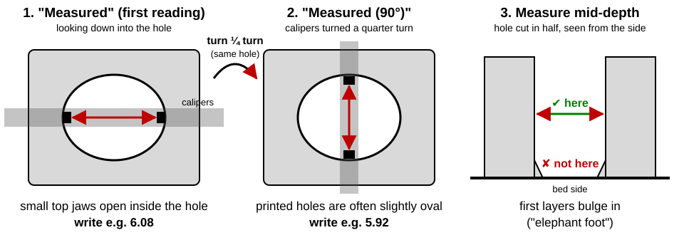

# Measurement sheet: CAD file vs real part

Fill in the **Measured** column and send it back. Every CAD value comes from `backend/cad/model.py`
(the `TOL` table and the part dimensions). From the differences, every hole and shaft in the robot gets
corrected in one go, and only the parts that need it are reprinted (`cad/print/reprint/`).

## How to measure (digital calipers)

- **Hole:** the small top jaws inside the hole; measure, turn the calipers 90°, measure again: write **both**.
  Measure in the middle of the hole's depth, not at the bed side (the first layer bulges out: "elephant foot").
  **"Measured (90°)"** = the same hole again with the calipers turned a quarter turn (like going from 12 to 3 on a
  clock). Printed holes are often a little oval, so the two numbers differ: both are needed.

  
- **Shaft / outside (hub, post):** the big jaws; two readings 90° apart, write **both**.
- **Length / width:** big jaws across the whole part, ~1 mm above the bed face.
- Don't squeeze: close the jaws until they just touch. Zero the calipers first.
- **Fit:** try the real part in it: **press** (needs force, stays), **snug** (slides in by hand, no play),
  **loose** (wobbles), **no** (won't go in).

## A. Bought parts (the real sizes everything is checked against)

| # | Part | Measure | Nominal | Measured | Measured (90°) |
|---|---|---|---:|---:|---:|
| A1 | 6 mm steel rod | outside diameter | 6.00 | | |
| A2 | LM6UU | outside diameter | 12.00 | | |
| A3 | 6807 bearing | outside diameter | 47.00 | | |
| A4 | 6807 bearing | inside (bore) diameter | 35.00 | | |
| A5 | 6807 bearing | width | 7.00 | | — |
| A6 | #6-32 screw | thread outside diameter | 3.51 | | — |
| A7 | #8-32 screw | thread outside diameter | 4.17 | | — |
| A8 | Servo-bag screw (small) | thread outside diameter | ~2.2 | | — |
| A9 | SG90 round horn | hub outside diameter (the round boss) | ~7 | | |

## B. Tolerance gauge (`cad/print/tolerance_test/`)

| # | Feature | CAD | Measured | Measured (90°) | Fit with the real part |
|---|---|---:|---:|---:|---|
| B1 | ROD hole 1 | 6.00 | | | rod: |
| B2 | ROD hole 2 | 6.15 | | | rod: |
| B3 | ROD hole 3 | 6.30 | | | rod: |
| B4 | ROD hole 4 | 6.45 | | | rod: |
| B5 | LM6UU hole 1 | 12.10 | | | LM6UU: |
| B6 | LM6UU hole 2 | 12.25 | | | LM6UU: |
| B7 | LM6UU hole 3 | 12.40 | | | LM6UU: |
| B8 | LM6UU hole 4 | 12.55 | | | LM6UU: |
| B9 | AXLE hole 1 | 3.90 | | | #6 screw turns freely? |
| B10 | AXLE hole 2 | 4.10 | | | |
| B11 | AXLE hole 3 | 4.30 | | | |
| B12 | HORN hole 1 | 6.80 | | | horn hub: |
| B13 | HORN hole 2 | 7.10 | | | horn hub: |
| B14 | HORN hole 3 | 7.40 | | | horn hub: |
| B15 | Ring, inside | 47.25 | | | 6807: |
| B16 | Post, outside | 34.80 | | | 6807: |
| B17 | Overall length | 180.9 | | — | |
| B18 | Overall width | 69.6 | | — | |

## C. Parts already printed (original plate 1)

| # | Part | Feature | CAD | Measured | Measured (90°) | Fit with the real part |
|---|---|---|---:|---:|---:|---|
| C1 | Turret plate | hub outside diameter (goes into the 6807) | 34.95 | | | 6807: |
| C2 | Turret plate | rod hole, left | 6.00 | | | rod: |
| C3 | Turret plate | rod hole, right | 6.00 | | | rod: |
| C4 | Turret plate | rod holes, centre to centre (inside-to-inside + one Ø) | 34.0 | | — | |
| C5 | Turret plate | overall width (round edge to round edge) | 80.0 | | — | |
| C6 | Turret plate | plate thickness | 6.0 | | — | |
| C7 | Top cap | rod hole, left | 6.00 | | | rod: |
| C8 | Top cap | rod hole, right | 6.00 | | | rod: |
| C9 | Top cap | screw hole (#6 clearance), one of the 2 | 3.90 | | | #6 passes? |
| C10 | Top cap | overall length × width | 54.0 × 44.0 | | — | |
| C11 | Lift link | big hole (carriage pivot) | 3.90 | | | #6 turns? |
| C12 | Lift link | small hole (old print: crank pin) | 1.70 | | | |
| C13 | Lift link | hole centre to centre | 9.36 | | — | |
| C14 | Base (only if printed) | bearing pocket inside diameter | 47.10 | | | 6807: |
| C15 | Base (only if printed) | overall length × width | 152.0 × 112.0 | | — | |

**Also note:** filament (brand, PETG), nozzle / bed temperature used, and which settings the part was printed with
(the original plate 1 used the old single-setting profile; the gauge used its own settings).

## What happens with the numbers

- A tells the real reference sizes (bearings and rods vary by maker).
- B and C give how much this printer shrinks holes and grows shafts at each size. One printer usually has a nearly
  constant offset, so 4–6 good readings correct everything.
- Then: `TOL` updated → checks re-run → `cad/print/reprint/` regenerated → print the reprint plates.

## Round 1 results (2026-11-23) and what changed

PETG 235 / 80 °C, 0.2 mm, uncalibrated CR-6 SE. Readings marked ~ are rough (caliper jaws too wide or the hole
half closed): used only to confirm the trend.

| Row | CAD | Measured | Error |
|---|---:|---:|---:|
| A1 rod / A2 LM6UU | 6.00 / 12.00 | 6.00 / 11.95 | bought parts are on size |
| A3 / A4 / A5 6807 | 47 / 35 / 7 | 47.00 / 35.00 / 6.94 | on size |
| A7 #8-32 thread | 4.17 | 4.06 | |
| B1–B4 rod holes | 6.00–6.45 | ~4.91–5.33 | ~ −1.10 |
| B5–B8 LM6UU holes | 12.10–12.55 | 11.00–11.50 | −0.92 … −1.10 |
| B12–B14 horn holes | 6.80–7.40 | 5.70–6.30 | −1.05 … −1.10 |
| B15 ring (inside) | 47.25 | 46.44 | −0.81 |
| B16 post (outside) | 34.80 | 35.60 | +0.80 |
| B18 overall width | 69.6 | 70.53 | +0.93 (~) |
| C1 turret hub (outside) | 34.95 | 35.28–35.63, mostly 35.5 | +0.55 |
| C4 rod holes, inside edge to inside edge | 28.0 (34.0 − 6.0) | 29.1 | holes ~4.9: −1.1 |
| C5 turret width | 80.0 | 80.24 | +0.24 |
| C6 turret thickness | 6.0 | 6.5–6.8 (~, rough bottom over supports) | +0.5 … +0.8 |
| C14 base pocket | 47.10 | 46.0 | −1.10 |
| carriage LM6UU pockets | 12.15 | ~11.1 (all 4) | ~ −1.05 |
| lift link holes | 3.90 / 1.70 | ~2.4 / closed | small holes close up even more |

**Result:** this printer makes every hole about **1.05 mm too small** in diameter (0.8–1.1 on the 47 mm rings) and round
bosses 0.55–0.80 mm too big; long flat outsides are close (+0.24 on 80 mm). The usual cause is over-extrusion plus the
wide first layer; calibrating flow (docs/18) would fix it at the source, but with the deadline the CAD is corrected
instead, for **these exact print settings** (the reprint files use the same layer height, speeds and temperatures as
the gauge). `TOL` in `backend/cad/model.py`:

| Fit | Old CAD | New CAD | Expected print |
|---|---:|---:|---:|
| 6 mm rod hole (press) | 6.00 | **7.05** | ~5.95 |
| LM6UU pocket (snug) | 12.15 | **13.00** | ~12.0 |
| 6807 pocket in the base | 47.10 | **48.00** | ~47.05 |
| Turret hub into the 6807 | 34.95 | **34.30** | ~34.9 (loose → one wrap of tape) |
| #6 clearance / claw axle | 3.90 | **4.80** | ~3.75 |
| #6 pilot / #8 clearance / #8 pilot | 2.9 / 4.6 / 3.5 | **3.9 / 5.6 / 4.5** | ~2.85 / 4.55 / 3.45 |
| Servo-screw pilot / pin hole | 1.7 / 2.4 | **2.7 / 3.5** | ~1.6 / ~2.4 |
