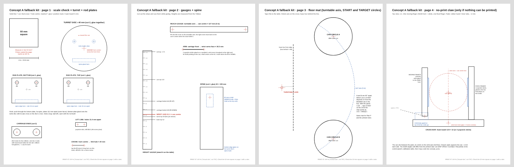

# Fallback: if the 3D printer doesn't work

The electronics, firmware and laptop panel are already proven, so none of that changes. Only the
**body** of the robot changes. Pick the highest option that works for you:

| Option | What's printed | Robot you get | Time |
|---|---|---|---|
| **0. Fix the printer** (1 evening, max) | — | the real one | `docs/15_cr6se_print_troubleshooting.md`, then print the coupon (`plate0`) |
| **A. Print somewhere else** | everything, by someone else | **the real one**, same as the CAD | quote + 1–5 days, see `print_service/` |
| **B. Plan P** | only the claw (2 small prints, ~4 h) | cardboard / foam body, real claw | ~1 day, `docs/14_plan_p_quick_prototype.md` + the templates here |
| **C. Zero print** | nothing | cardboard / foam body, simple 1-finger claw | ~1 day, this page + `cut_templates.pdf` |

**Rule of thumb:** if the printer fails twice on the coupon or the claw prints, stop fighting it and
send the files out (A) while you build B or C in parallel. The calibrated angles from B/C carry over
to the printed robot.

## What's in this folder

| File | What it is |
|---|---|
| `cut_templates.pdf` | 4 US-Letter pages, **1:1**: print at 100 % ("Actual size"), check the 50 mm square with a ruler |
| `templates_preview.png` | the 4 pages at a glance |
| `print_service/` | STL zips + the order sheet to hand to a makerspace or an online print service |

| Page | Templates |
|---|---|
| 1 | Scale check · turret disc (r 40) with horn, rod and spine marks · 2 rod plates (rods Ø6, 34 mm apart) · carriage ends (LM6UU Ø12) · lift link (11.4 mm holes) · crank gauge (20 mm) |
| 2 | Height gauge (wrist axis **61.1 mm**, carriage 69 / 84, base 52, turret 59) · reach gauge (**127 mm**) · arm length (36.5 mm) · spine 40 × 109 with the lift-servo mark |
| 3 | Floor mat: turntable axis, the 127 mm arc, the two can circles 90° apart, base front edge |
| 4 | No-print claw, top view 1:1 (only for option C) |

Every number comes from `backend/cad/model.py`, the same as the printed robot. Regenerate with
`python3.13 backend/tools/make_fallback_templates.py`.

## Option C: zero-print build

**Materials:**
- **Body:** cardboard box ≥ 52 mm tall (shoe box), foam board (2 sheets, 5 mm), popsicle sticks.
- **Fixing:** hot glue, zip ties, double-sided tape.
- **Claw pads:** rubber band or bike inner tube.
- **Tools:** ruler, box cutter, a small drill or a hot nail for the holes.
- **Bought parts:** the 4 servos, the rods and LM6UU, and the electronics, as already bought. The 6807 bearing is not used.

**Three numbers matter; the shapes don't.**
1. **61.1 mm**: table to the wrist axis (the can's middle).
2. **127 mm**: turntable axis to the can's centre.
3. The **wrist axis runs through the can's centre**.

| Stage | Build (template page) | Test with the laptop panel | Pass |
|---|---|---|---|
| C1 Base | MG996R hot-glued inside the box, horn out through a hole in the top. Box front edge 20 mm in front of the axis (p 3). Weight inside (rocks / coins, glued) | `t 135` / `t 45` | Horn turns 90°, box doesn't move |
| C2 Turret | 2 discs glued together (p 1), screwed to the MG996R horn on the red cross | `t 135` / `t 45` | Disc turns, wobble at the edge < 3 mm |
| C3 Column | Spine (p 2) glued on the disc's spine mark. Rod plates (p 1): rods through, plates 112 mm apart, bottom plate glued on the disc | Push the rods sideways | Rods stay parallel (check with the carriage ends: they must slide down both rods together) |
| C4 Lift | Carriage: 2 ends (p 1) + foam sides 62 mm tall, 4 LM6UU glued + zip-tied. Lift MG90S glued on the spine mark, crank hole at 20 mm (p 1 gauge), popsicle-stick link 11.4 mm (p 1) | `l 30` / `l 75` | Carriage rises ~15 mm, no sticking. At `l 30` its bottom is at **69 mm** (height gauge) |
| C5 Arm + wrist | 2 popsicle sticks, 36.5 mm from the carriage front (p 2). Wrist MG90S glued at the end, shaft pointing at the can | `w 0` / `w 180` | Shaft centre at **61.1 mm** on the height gauge with the lift DOWN |
| C6 Claw | Cross bar on the wrist horn, fixed finger + SG90 moving finger (p 4), pads | Calibration table: GRIP OPEN / CLOSED | Can held when you shake it and turn it upside down by hand |
| C7 Whole run | Floor mat taped down (p 3), axis on the cross. `t 135` → tape START on that circle | Panel START, or the button | Can ends **upside down at TARGET, standing**, 3 runs out of 5 |

**Firmware:**
- **Same `concept_a.ino`.** Only the angles may move a few degrees.
- **Set them in the control panel.** Use the calibration table: "Use current angle" on each row, then **Copy code** into `concept_a.ino` and upload.
- **The gripper needs new numbers.** The no-print claw's SG90 has its own OPEN, CLOSED and RELEASE angles, different from the printed claw's.

**Limits of option C (say so in the report):**
- Foam bends more than PETG.
- The single-finger claw doesn't test the gear mesh.
- The turret rides on the MG996R's own bearing instead of the 6807.
- Electronics, firmware, motion, timing, wire lengths and the calibration are all tested for real.

## Swapping to printed parts later

If the parts arrive (option A) or the printer is fixed, swap one module at a time:
1. Claw.
2. Carriage + arm.
3. Column.
4. Base.

After each swap, check its row above again. The robot keeps working the whole time. Then follow the
assembly manual (`docs/12_assembly_manual.pdf`, PART M) for the final build.
